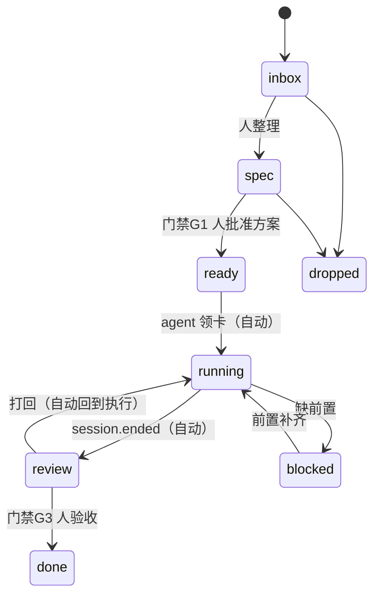

# flowcard 设计

> 只有你一个人用的工作台：**卡片即会话**，流程是固定的一段可执行代码，节点分自动与人工两类。

## 1. 定位与非目标

**做**：承载任务状态与门禁；挂载并观察 agent 会话；给 agent 一个稳定的写入通道（CLI/HTTP）；把"该你拍板"的地方显式摆出来。

**不做**（明确排除，避免重写成又一个通用 tracker）：

| 不做 | 原因 |
|---|---|
| 起 agent / 管 subagent | 执行归 harness，我们只做交互与门禁 |
| 多用户、权限、账号 | 单机单用户，只监听回环 |
| Jira / 云同步 / 桌面壳 / Codex 注入 | 与目标无关，全是维护面 |
| 附件、富文本、甘特、依赖图、i18n | 第一版不要；需要时再评估 |
| 模型调用 | 引擎是确定性的（事件→条件→动作）。真要 LLM，外部 `omp -p` 一句调用即可 |

## 2. 核心概念：Card ≡ Session（1:1）

一张卡片 = 一个工作单元 = **一个** agent 会话。

- 卡片是根：可以先有卡（只有需求、无人干），躺在待开工列等你批准执行。
- **会话在"领卡"那一刻诞生**；`claim` 时若该卡已有活跃会话 → 拒绝（`409 SESSION_ACTIVE`）。
- 会话断开可以用 harness 自带命令恢复（如 `omp -r <session>`），**id 不变**，1:1 不破。
- 会话结束（`session.ended`）→ 卡片落"待验收"或"阻塞"，**卡片完成仍然只能由人放行**。
- subagent、工具调用、内部循环 **不建模**，只作为会话活动的可选项（第一版连这个都不收）。

推论：不需要"会话台账"表。会话身份是卡片上的一组字段：

```ts
type Session = {
  harness: "omp" | "codex" | "claude" | "other";
  id: string;              // harness 侧会话标识（omp 用会话文件路径）
  state: "idle" | "running" | "ended" | "lost";  // lost 由心跳超时推出
  startedAt: string;
  lastSeenAt: string;      // 心跳
  resumeHint?: string;     // 会话恢复命令，展示用
};
```

## 3. 流程状态（看板的列）

| 状态 | 含义 | 谁推进 |
|---|---|---|
| `inbox` | 原始需求刚进来，还没整理 | 人 |
| `spec` | 方案确认中（agent 探索、写方案） | agent 产出，**人等批准** |
| `ready` | 方案已批准，可以开工 | 人批准（门禁 G1） |
| `running` | 会话执行中 | agent 领卡（自动） |
| `review` | 待验收 | agent 交回（自动） |
| `done` | 完成 | **人验收**（门禁 G3） |
| `blocked` | 缺前置，卡住 | 人/agent，需写明缺什么 |
| `dropped` | 放弃 | 人 |



## 4. 门禁（人工节点）

门禁 = 一个**待你决策的对象**，未决时阻塞对应转换。三种：

| 类型 | 触发时机 | 谁批 |
|---|---|---|
| `approve` | `spec → ready`：方案成型，等你点头才许开工 | 人 |
| `confirm` | agent 想执行**外部写动作**（push / 建 PR / 评论到远程）时申请；一次授权只覆盖一次 | 人 |
| `review` | `review → done`：验收交付物 | 人 |

约定：一张卡同一时刻**最多一个未决门禁**；门禁带 `requestedBy`、`payload`（要批的到底是什么，如 diff/PR 链接）、`decision`（approved/rejected + 理由）。`confirm` 门禁刻意做成**一事一议**，用来把你"每次远程写都要单独确认"的规矩变成机器可执行的形状。

## 5. 事件日志是真相

- 所有写入都是 **append-only 事件**；`cards` 表是可重建的投影（`flowcard rebuild` 能从零重放）。
- 每条事件：`{ id, at, actor{kind: human|agent|system, harness?, sessionId?}, cardId, type, payload, dedupeKey }`。
- **幂等**：`dedupeKey` 全局唯一索引；重复写入直接返回原事件（不报错、不重复）。默认由 `(actor, type, cardId, 关键字段)` 派生，也可 `--dedupe-key` 显式给。
- **不抄 dashi 的 `--if-version` 往返**：那边的写是"整条记录覆盖"，所以要版本号；这边命令是**意图**（`approve` / `claim` / `comment`），引擎按当前状态校验即可。需要断言时用可选的 `--if-state <状态>`。

事件类型（v1）：

```
card.opened            card.state.changed      card.comment.added
card.artifact.added    gate.requested          gate.decided
session.started        session.heartbeat       session.ended
git.probed             note.added
```

## 6. 流程 DSL（TS 代码）

流程本身是一段**有类型的代码**，不是配置表——条件可以随意写。

```ts
// src/flow/personal.ts
import { defineFlow } from "../shared/flow.ts";

export default defineFlow({
  states: ["inbox", "spec", "ready", "running", "review", "done", "blocked", "dropped"],

  guards: [
    { id: "G1", on: ["spec", "ready"], kind: "approve", title: "批准方案" },
    { id: "G3", on: ["review", "done"], kind: "review", title: "验收" },
  ],

  automations: [
    { name: "claim-on-start", on: "session.started", do: [{ setState: "running" }] },
    { name: "review-on-end", on: "session.ended", when: (c) => c.state === "running",
      do: [{ setState: "review" }] },
    { name: "probe-git-on-artifact", on: "card.artifact.added",
      do: [{ probeGit: true }, { comment: "已记录交付物" }] },
  ],
});
```

引擎形状：`decide(card, event, flow) -> Action[]`，**纯函数**，不碰 IO；执行动作的适配器（写库、探测 git、发通知）在薄层里。这样流程语义能被单测逐条钉住。

## 7. 写入通道

**HTTP**（Hono + zod，仅回环）：

| 方法 | 路径 | 说明 |
|---|---|---|
| POST | `/api/events` | 批量 append，幂等由 `dedupeKey` 保证；返回每条事件的结果 |
| GET | `/api/cards` `/api/cards/:id` | 投影读 |
| POST | `/api/session/heartbeat` | 会话上报（harness 适配器用，轻量、允许高频） |
| GET | `/api/stream` | SSE：事件广播，前端唯一推送来源 |
| POST | `/api/gates/:id/decide` | 人在看板上点批准/驳回 |

**CLI**（agent 的唯一写入口，`--json` 输出、`schemaVersion`、语义化退出码）：

```
flowcard open  --title "…" [--body …]          # 开卡（inbox）
flowcard spec  <card> --body "方案…"            # 写方案并申请 G1
flowcard claim <card> --harness omp --session <id>   # 领卡（会话说：我开始了）
flowcard beat  <card> --harness omp --session <id>   # 心跳
flowcard end   <card> --harness omp --session <id> --summary "…"
flowcard accept <card>                          # 人验收（G3 通过）
flowcard list / show <card>                     # 读
```

退出码：`0` 成功；`2` 用法错；`3` 状态不允许（如未批准就想 claim）；`4` 会话冲突；`5` 服务不可达。

## 8. 会话上报（harness 侧适配器）

每个 harness 一个薄适配器，把生命周期事件打到 `POST /api/session/heartbeat`：

| harness | 接入面 | 状态 |
|---|---|---|
| omp | 扩展 / hook（`-e`、`--hook`、`omp install ./dir`） | **M0 先打这个 spike** |
| codex | `hooks` feature（`SessionStart`/`SessionEnd`/…） | 后置 |
| claude | hooks | 后置 |

存活判定：`heartbeat` TTL 默认 30 s；超时把 `session.state` 标为 `lost`（**只改徽标，不自动改流程状态**——误判会毁掉信任）。适配器崩溃必须**不影响 agent 会话**。

## 9. 数据与运行

- 数据目录 `~/.local/share/flowcard/`（可用 `FLOWCARD_DATA_DIR` 覆盖），`db.sqlite` + WAL；备份即拷目录。**不塞进项目目录**。
- 运行：`systemd --user` 常驻 + 回环监听（模板沿用 dashi 那个 unit 的形状）。
- Node 22 原生跑 TS（type stripping），无构建步骤；看板前端另用 Vite。

## 10. 里程碑

| 里程碑 | 内容 | 验收 |
|---|---|---|
| **M0（风险 spike）** | omp 扩展上报 `session.started/heartbeat/ended` 到本地 HTTP | 真实 omp 会话跑一次，三个事件都落库 |
| **M1 内核** | 事件日志 + 投影 + 引擎纯函数 + CLI + HTTP + SSE | CLI 走完 `open→spec→批准→claim→beat→end→验收`；重启后状态一致；`rebuild` 可重放 |
| **M2 看板** | React + Vite + shadcn；列=状态，卡片=会话徽标/心跳/恢复按钮/门禁待办 | 浏览器里完成 M1 全部动作，SSE 实时 |
| **M3 门禁闭环** | `approve`/`confirm`/`review` 三类 + 一事一议的"远程写确认" | agent 申请 push 确认 → 卡片上出现待办 → 点后方可继续 |
| **M4 git 探测** | 分支/worktree/PR 状态（`git` + `gh`/`tea`）挂到卡片"交付物" | 卡片上能看到分支与 PR 状态 |

顺序：**M0 先行**（结论决定数据模型），再 M1 → M2 → M3 → M4。
