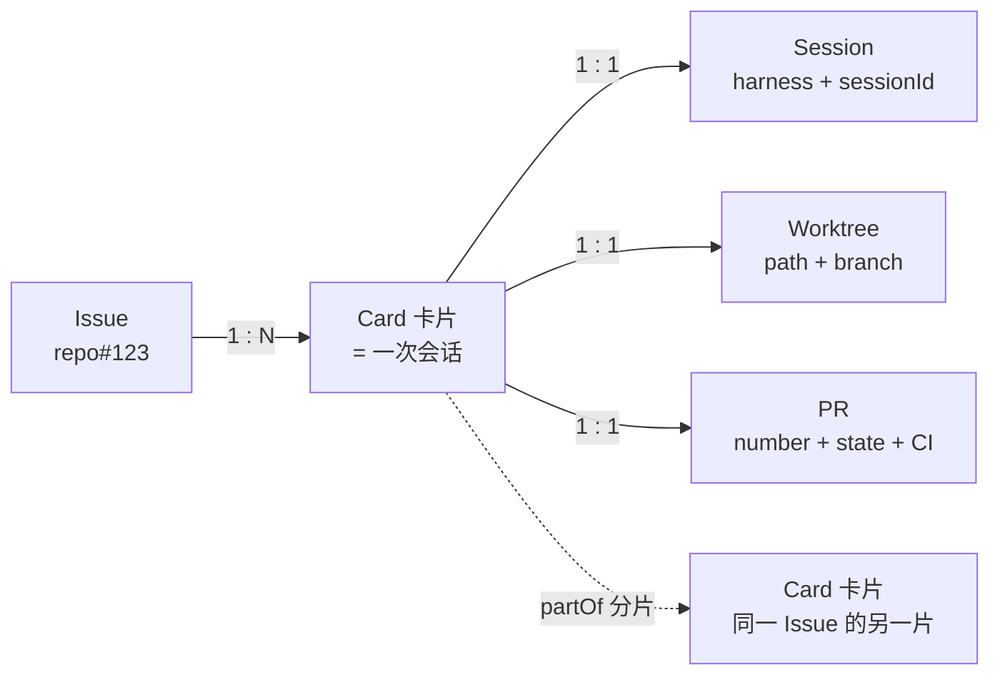
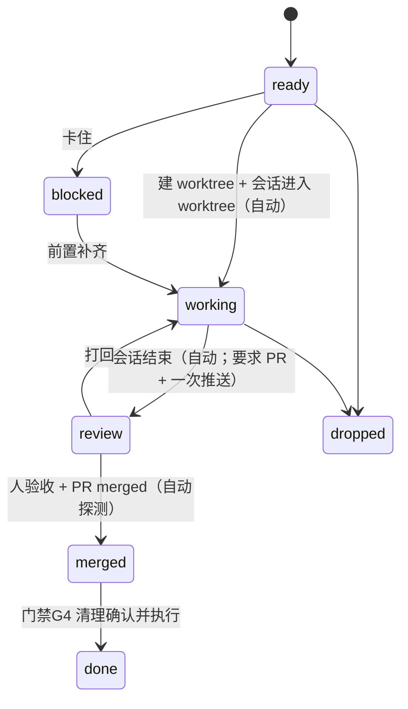

# flowcard 设计

> 只有你一个人用的工作台：**卡片即会话**；每张卡必须携带 **Issue / worktree / PR / 清理** 四项交付要件；流程是固定的一段可执行代码，节点分自动与人工两类。

## 1. 定位与非目标

**做**：承载流程状态与门禁；把交付要件（Issue、worktree、PR、清理）变成卡片上**永远可见的槽位**；挂载并观察 agent 会话；给 agent 一个稳定的写入通道（CLI/HTTP）。

**不做**：

| 不做 | 原因 |
|---|---|
| 起 agent / 管 subagent | 执行归 harness，我们只做交互与门禁 |
| 多用户、权限、账号 | 单机单用户，只监听回环 |
| 代码审查工具 / CI 系统 | 我们只**记录** PR 与 CI 状态，不做审查；§12 的评审只是**本地**记录（行级评论 + 判定），不回写 forge、不代替人点验收 |
| Jira / 云同步 / 桌面壳 / Codex 注入 | 与目标无关，全是维护面 |
| 附件、富文本、甘特、依赖图、i18n | 第一版不要 |
| 模型调用 | 引擎是确定性的（事件→条件→动作） |

## 2. 实体模型



- **Issue 是外部实体**（仓库里的 issue），卡片只持弱引用 `{repo, number, url, title, state}`。
- **绑 Issue 只填数字**：`repo` / `url` 由项目的 Issue 基址（`Project.issueRepo` / `issueUrlTemplate`，默认按 git remote 派生）补齐；项目没基址时展开「高级」手填 url，或去项目面板配模板。
- **一个 Issue 可以对应 N 张卡片**：大需求分多个 PR，每张卡一片、一个会话、一个 PR。
- **Card : Session : Worktree : PR 都是 1:1**。
- **Issue 与 PR 两个槽位永远存在**：没绑定就是 `null`，但**必须渲染出来**（"未绑定" + 可执行的动作），不允许隐藏。

```ts
type Card = {
  id: string;
  title: string;
  body: string;
  state: CardState;
  projectId: string;               // 归属项目（Project.id）；老卡片投影成 "local"
  issue: IssueRef | null;          // 永远存在，可为 null
  pr: PrRef | null;                // 永远存在，可为 null
  worktree: WorktreeRef | null;    // 永远存在，可为 null
  session: Session | null;         // 领卡后才有（agent 会话）
  runtime: Runtime | null;         // 卡片自己的项目运行时（启动按钮管的就是它）
  partOf?: string;                 // 分片：同 Issue 的兄弟卡
  acceptedAt?: string;             // 已验收（等合并）
};

type Session = {
  harness: "omp" | "codex" | "claude" | "other";
  id: string;                      // harness 侧会话标识（omp: getSessionId()，UUID）
  agentKind: "main" | "sub";       // 只有 main 才绑卡片（subagent 也会 emit session_start）
  cwd: string;                     // 每次上报都带 —— 用来校验"会话真的在 worktree 里"
  state: "idle" | "running" | "ended" | "lost";   // lost = 心跳超时
  startedAt: string;
  lastSeenAt: string;
  resumeHint?: string;             // 恢复命令（omp: omp -r <id>）
};

type Runtime = {
  status: "stopped" | "starting" | "running" | "failed";
  pid?: number;                    // 只记自己启动的进程组
  startedAt?: string;
  ports?: number[];                // 探活/冲突提示用
  logPath?: string;
};

type IssueRef  = { repo: string; number: number; url: string; title?: string; state: "open" | "closed" };
type PrRef     = { repo: string; number: number; url: string; branch: string;
                   state: "draft" | "open" | "merged" | "closed"; ci?: "pending" | "pass" | "fail" };
type WorktreeRef = { path: string; branch: string;
                   source: "harness" | "flowcard" };   // 谁建的：harness 的 /wt，还是 flowcard 自己 add
```

### 2.1 项目 = 看板的 Metadata（进入看板先选项目）

**一个实例管若干 git 仓库，项目就是这些仓库的元数据**：进来先选项目，建卡只填正文，`repo` 不再手填。

```ts
type Project = {
  id: string;              // 由仓库根路径派生：仓库目录名 + 路径哈希前 4 位（短、稳定、可读）
  name: string;            // 默认仓库目录名
  path: string;            // 仓库根绝对路径（git rev-parse --show-toplevel）
  remote?: string;         // git remote get-url origin
  headBranch?: string;     // rev-parse --abbrev-ref HEAD（detached 时缺省）
  defaultBranch?: string;  // origin/HEAD 指向的分支；拿不到就回退到存在的 main / master
  lastCommit?: { sha: string; subject: string; at: string };
  dirtyFiles?: number;     // git status --porcelain 的行数
  issueRepo?: string;         // Issue 基址：绑 Issue 只填编号，repo/url 从这里补（按 remote 派生，可显式覆盖）
  issueUrlTemplate?: string;  // 形如 https://host/owner/repo/issues/{number}；{number} 换成编号
  virtual?: boolean;       // 仅本地存在的合成项目（只有 id="local"、name="未归属"）
  addedAt: string; lastSeenAt: string;
};
```

- **Issue 基址由项目派生**（`server/projects.ts` 的 `deriveIssueBase`，纯函数）：登记项目时从 `remote` 算出 `issueRepo`（去掉 `.git` 的整段 path）与 `issueUrlTemplate`（`<scheme>://<host>[:port]/<path>/issues/{number}`）。认得的形态：`git@host:owner/repo(.git)`（scheme 取 `https`）、`ssh://git@host[:port]/owner/repo(.git)`、`https?://host[:port]/owner/repo(.git)`；Gitea 的多段路径（`/git/Owner/Repo`）整段保留。**认不出（`file://`、本地路径、只有一段 path、盘符）就两条都空 —— 不瞎猜**，此时绑 Issue 必须显式给 `--url`，或用 `flowcard project issue-base` 配一次。
- 于是**绑 Issue 只填编号**：`bindIssue` / `open --issue` 缺 `repo`/`url` 时用卡片所属项目的基址补齐（引擎纯函数，项目由 store 注入），存的仍是完整的 `IssueRef`（六格必要项不变）。项目没基址又没显式给 → `USAGE_ERROR`，hint 指明两条出路（配基址 / 这次显式给）。基址是**项目元数据**（不进事件流），所以改基址不影响已绑的 Issue，也不会让 rebuild 结果漂。
- **`local` 是必有的合成项目**（`virtual:true`、`path:""`）：所有没归属的卡片、以及**升级前的老卡片**都落在这里，看板上一样能看见。所以 `Card.projectId` 必填（缺省就是 `local`）。
- `repoPath` 仍留在卡片上，但**由 `projectId` 解析出来**（引擎在建卡时把 `project.path` 写进事件），客户端不再传。运行时/探测继续读 `card.repoPath`，不用改。
- **项目用单独的表，不进事件流**：它是"环境元数据"（仓库现在长这样），刷新它不该在看板历史里堆噪声，也没有"谁在什么时候做了什么"要重放。而**卡片归属（`Card.projectId`）走事件**——那是业务事实，必须能重放。投影版本因此 +1（v3），启动时自动 rebuild 一次，老卡片补成 `local`。
- 登记幂等：同 `path` 重复登记只刷新元数据（分支/远程/脏文件会变），`id` 与 `addedAt` 不动；解析按**路径段**比较（复用 `src/shared/paths.ts`，`/a/b` 不匹配 `/a/bc`），嵌套仓库取最具体的那个。
- 只跑只读 git 子命令（`rev-parse` / `remote get-url` / `log` / `status`），**不 fetch、不 push**。

### 2.2 附件 = 图片（正文/评论里直接贴）

- `POST /api/attachments?name=<文件名>`，body 是原始字节 → `{ id, url, markdown, bytes, mime }`；`GET /api/attachments/<id>` 回原始字节。
- **`id` = 内容 sha256 前 16 位** → 内容寻址：同一张图重复上传是同一个 id（天然去重 + 幂等），字节落 `<dataDir>/attachments/<id>.<ext>`。
- 白名单只有 `image/png | image/jpeg | image/gif | image/webp`，单文件 ≤ 10MB。**不收 svg**：svg 里能塞脚本，等于把 XSS 面挂到看板上；**声明什么不算数**，一律按文件头字节嗅探，声明与内容不符也拒。
- GET 带长缓存（`max-age=31536000, immutable`：内容寻址，同一个 id 的内容永不改变）+ `X-Content-Type-Options: nosniff`。
- **标题可选**：`open` 不给 title 时由**服务端**从正文派生（第一条有文本的段落 → 去 markdown 语法 → 折叠空白 → 截 40 字符；纯图/空正文 → `未命名卡片`），并把派生结果**写进事件**——历史稳定，不随规则重算而变。

## 3. 卡片上的"必要项目"（checklist，永远显示）

每张卡片的详情页固定六格，**空着也要显示**，空槽位旁边给出该动作（并标出它属于本地动作还是远程写）：

| # | 必要项目 | 完成判据 | 动作性质 |
|---|---|---|---|
| 1 | **Issue**（建或查） | `issue != null` | 远程写（建 Issue）→ 需确认 |
| 2 | **worktree + 分支** | `worktree != null` **且 `session.cwd` 落在 `worktree.path` 内**（会话真的在里面干活）；分支名按改动性质起（前缀跟仓库惯例：feat / fix / chore / docs / refactor…） | 本地：`flowcard worktree use`（把会话搬进去；不再靠斜杠命令） |
| 3 | **WIP PR** | `pr != null`（任务一开始就建） | 远程写 → 需确认 |
| 4 | **推送记录** | 至少一条 push 事件（每天可见进度） | 远程写 → 需确认 |
| 5 | **验收** | `acceptedAt != null`（人明确验收） | 人工门禁 |
| 6 | **清理** | 合并后按报告清单拆掉现场 | 人工门禁（报告 → 同意 → 执行） |

**绑 Issue 只填编号**：`repo`/`url` 由卡片所属项目的 **Issue 基址**（`issueRepo` / `issueUrlTemplate`，登记项目时按 remote 派生，§2.1）补齐；项目没基址就用 `flowcard project issue-base` 配一次，或这次显式给 `--repo` / `--url`。

**Issue 是必要项目，不是阶段**：`flowcard issue <card> --number N` 只是把槽位填上（顺手也随时能做），**不挡任何动作**——建卡即 `ready`，要开工不需要先绑 Issue。

硬约束（引擎拦截，不是提醒）：

- **建卡即开工**：`open` 直接落 `ready`，不做"确认要做 / 方案批准"这类中转。
- **会话没进 worktree 就不算开工**：`ready → working` 要求 `worktree != null` **且** `session.cwd` ⊆ `worktree.path`（见 §3.1）；**PR 不挡开工**。
- 未开 PR、一条推送都没有 **不许进入 `review`**（这是交付要件：PR 挡交付，不挡开工）。
- 必须由人**明确验收**，且 PR 已 `merged`，**才允许进入 `merged` 列**。
- 未清理 **不许 `done`**。
- **PR 合并前绝不清理**：`merged` 之前的任何清理动作一律拒绝。

### 3.1 会话必须进入 worktree 里工作

光建 worktree 不算数——**必须让会话本身在 worktree 里干活**，否则 agent 会继续在主干目录上改文件，等于白建。

事实（omp 18.8.6 实测命令表）：omp 原生支持这条路径，不用我们造轮子

| omp 命令 | 作用 |
|---|---|
| `/wt [<branch>]`（别名 `/worktree`） | **把当前会话移进一个新 worktree，连同未提交改动一起带过去** |
| `/move [<path>]` | 把当前会话移到另一个目录 |
| `/dirs` `/add-dir` `/remove-dir` | 会话的工作目录集合（只读/增删） |

**2026-10-10 修正：斜杠命令是死路 —— 模型调不了它**（真机原话「/move 是斜杠命令，我执行不了」）。
于是这条路径改由 **flowcard 自己做**，agent 只需一条可执行命令：

```bash
git worktree add .worktrees/<名字> -b <前缀>/<名字>          # worktree 还是 AI 自己建（名字按任务起）
flowcard worktree use <card> --path .worktrees/<名字>        # 登记 + 把会话搬进去（一条命令做完）
```

`worktree use` 做三件事：① 按既有 `worktree` 命令把 worktree 绑到卡片（**相对路径仍按项目根解析**；
`--branch` 不给就按目录里的 HEAD 推）；② 停掉当前托管会话、用新 cwd **续接同一条 omp 会话**
（`POST /api/cards/:id/session/cwd`）；③ 新会话起来后自己重新 claim（cwd 已在新目录）→ 卡片自动进「实施中」。

**omp 的坑（18.8.7 真机实测）**：`omp -r <会话文件>` 时工作目录取自**会话文件头里的 `cwd`**，`--cwd` 会被忽略；
所以换目录必须给一份**改过 `cwd` 头**的副本（`hosted-session.ts` 的 `writeHandoff`：拷进新目录对应的会话目录，
原会话文件保持不动）。续接保留同一个 omp sessionId，网页转录在卡片上连续追加。

配套的校验与兜底（都是自动的，不靠人自觉）：

1. **每次心跳都带 `cwd`**（M0 已验证 payload 含 `cwd`）→ 引擎拿 `cwd` 与 `worktree.path` 做前缀校验，**通过才允许 `ready → working`**。
2. 未通过时卡片停在 `ready`，并给出确切修复动作：`flowcard worktree use <card> --path <worktree 路径>`（建好 worktree 之后一条命令搬进去）。
3. 进入 `working` 之后若 `cwd` 漂出 worktree（又切回主干等）→ 记 `card.cwd.mismatch` 事件，卡片显示警告并回到"未在 worktree"状态（**不改流程状态**，只提示 + 门禁收紧：不许提交、不许 `review`）。
4. `worktree` 槽位里的 `path`/`branch` 优先**从 cwd 反查**（`git -C <cwd> rev-parse --show-toplevel --abbrev-ref HEAD`），避免人手工填错；期望落在项目仓库的 `.worktrees/` 下，不在则记警告但仍接受。
5. **卡片自动识别（M6）**：会话不用再报卡片 id——适配器 `claim` 不给 `card`，服务端按 `session.cwd` 落在谁的 `worktree.path` 里反查（路径段比较，`/a/b` 不匹配 `/a/bc`；多张命中取**路径最长**的那个），零命中或并列最长就回 `NOT_FOUND`，`hint` 里列出可用卡片当参照物。`FLOWCARD_CARD` 保留为显式覆盖。

### 3.2 卡片可以启动自己的项目（运行时）

每张卡片有**一个启动按钮**，启动的是**这张卡片 worktree 里的项目**（dev server / 预览栈之类）。会话是 agent 在干活，运行时是项目在跑——两者都由卡片持有，互不影响。

**每个项目怎么启动是可配置的**：项目仓库内放 `.flowcard.toml`（跟代码一起走、可 review），`[runtime]` 段描述 `cmd`、`cwd`（默认卡片 worktree）、`env`、`ports`、`ready`（按端口或日志正则判就绪）、`singleton`。取不到配置时按钮给出人话错误，而不是崩。

**单例不变式（明确要求）**：启动一张卡的运行时，**先停掉其他卡片已经启着的运行时**（把被停的卡片 id 回给调用方，UI 上要显示出来）。理由很实际：端口、GPU、显存这类资源同时只能给一套栈。`singleton = false` 可关掉（或收窄成"只在同一项目内互斥"）。

**安全边界（硬要求）**：

| 允许 | 禁止 |
|---|---|
| 只对 flowcard 自己启动的**进程组**发 `SIGTERM`，宽限期后 `SIGKILL` | 用 `pkill` / 模式匹配去杀别人的进程 |
| 服务重启/退出时清理自己留下的残留进程 | 杀掉不是自己启动的任何东西 |

**与"多开 subagent"的关系**：会话（含 harness 自己开的 subagent）**可以并行、不受运行时单例限制**；单例只约束"项目进程同时只跑一套"。卡片绑定会话仍然只认 `agentKind === "main"`，subagent 归 harness 自己管。

CLI：`flowcard up <card>` / `flowcard down <card>`；状态变化一样走事件流（`runtime.*`），所以 `rebuild` 之后按钮状态不会漂。

## 4. 流程状态（看板的列）

**人只做三件事：远程写授权、验收、清理确认；其余状态由事实自动推进。**

| 状态 | 含义 | 出口条件 |
|---|---|---|
| `ready` | 待开工（建卡即此状态，Issue 可有可无） | 建好 worktree **并用 `flowcard worktree use` 把会话搬进去** → `working` |
| `working` | 实施中（worktree 已建、会话在里面干活，多次推送） | 会话结束 / agent 交回 → `review`（`end` 要求 PR 已开 + 至少一次推送） |
| `review` | 待验收（子徽标：待验收 / 已验收待合并） | 人验收（G3）+ 探测到 PR `merged` → `merged` |
| `merged` | 已合并，**待清理**（此处验证现场必须完整保留） | 门禁 G4：报告清理清单 → 同意 → 执行 → `done` |
| `done` | 完成（现场已清理） | — |
| `blocked` | 卡住（必须写明缺什么） | 前置补齐 → `working` |
| `dropped` | 放弃 | — |



老库里的 `inbox` / `issue` 事件**原样保留**，只是投影时一律折成 `ready`（`PROJECTION_VERSION` v5 触发一次 rebuild）。

**大需求拆多片**：agent 可以在同一边界内**自己新建卡片**（`flowcard spawn`），新卡自动继承 `issue`、带 `partOf` 指向原卡、并要求它自己开一个新 PR。看板上按 Issue 分组显示"这个 Issue 下有哪几片、每片什么状态"。

## 5. 门禁（人工节点）

**只剩两道流程门禁（G3 验收、G4 清理）**；远程写是凭据（G2），不是流程节点。

| 门禁 | 位置 | 批什么 |
|---|---|---|
| `G2 confirm` | 任何**远程写**：建 Issue、push、开/改 PR、远程评论、合并 | **一事一议**：一次授权只覆盖一次动作，`detail` 带上将要执行的确切命令/URL |
| `G3 review` | `review → merged` | 明确验收（不看内容不算过），且 PR 已合并 |
| `G4 cleanup` | `merged → done` | 先报告"删什么、为什么现在可以删、对应 PR 状态"，同意后才执行 |

约定：一张卡同一时刻**最多一个未决流程门禁**；门禁带 `requestedBy`、`payload`、`decision`（approved/rejected + 理由）。

### 5.1 G2 是凭据，不是流程节点

上面那条「最多一个未决」只管 G3/G4。**G2 不占 `card.gates`，单独放 `card.confirmations`**：它是「这一次操作」的一次性授权，可以有多条、有历史、可以重复申请。

```
agent: requestConfirm{action, detail}   → confirm.requested（pending，detail = 将执行的确切命令/URL）
人:    decideConfirm{id, approved|rejected, reason?} → confirm.decided
agent: consumeConfirm{id}               → confirm.consumed（这条授权就此作废）
```

- **一次批准只覆盖一次动作**：`consumeConfirm` 成功后再执行第二次远程写，必须重新 `requestConfirm`（被 consume / 被驳回的那张永久失效，不能再被 consume）。
- 从措辞推断授权一律不算：`detail` 必须是**这条命令或这个 URL**，且长度有下限；空话、模糊描述连申请都提交不了。
- 驳回**必须写理由**，否则报 `USAGE_ERROR`（agent 要靠它改 detail 再申请）。
- 看板**只申请 / 批准 / 记录**（设计 §10）：`git push`、`tea pr create` 由 agent 或人自己敲。
- 幂等：同一条申请重复发送不会产生第二条；但一件已经结算（用掉/被拒）的事再申请，算**新的一次申请**。

### 5.2 审批 hook：人做完决定，自动通知在干活的 agent

人在看板上点「批准 / 驳回」之后，**不该再要人跑到终端里喊一声** —— 服务自己会把一条人话通知投给这张卡的托管会话（§14）：

```
人的决定：decideGate / decideConfirm / accept，且 actor.kind === "human"
  → 命令成功（决定事件真的落库；被拒或被幂等吞掉的不算）
  → 投一条通知进这张卡的托管会话：
       【flowcard 审批通知】人已批准清理（G4 清理确认）。
       理由：现场没用了
       下一步：现在可以执行清理：`flowcard cleanup c3` 记账，然后把现场清掉（worktree / 分支 / 临时文件）—— 完成后卡片自动进「完成」。
```

- **三件事必须都在**：决定（通过 / 驳回）、理由（有就带；驳回本来就必须给）、**下一步该做什么**。下一步按**卡片当前状态**给，不硬写死：`merged` → "先提清理清单 / 现在可以执行清理"，`review` → "等 PR 合并"，`done` → "没有待办了"。文案是纯函数（`approvalNotice(spec, card)`，见 `src/server/approval-hooks.ts`），所以能单测。
- **谁能触发**：`decideGate` / `decideConfirm` / `accept` 三条命令，且 `actor.kind === "human"`。agent 自己在看板外调这三条（自动化跑流程）不算"人的审批"，**不通知自己**。
- **只投一次**：幂等键就是那次决定本身 —— `approval:<card>:gate:<gate>:<decision>` / `approval:<card>:confirm:<cf-id>:<decision>` / `approval:<card>:accept`。重复决策（门禁已经不是 `open`、确认已经结算、卡片已经验收过）在引擎那层就被拒/跳过，**一条事件都不写**，hook 也就不动；同一条命令重发（事件被幂等键吞掉）同理。
- **会话不在线不静默丢**（降级）：写一条卡片评论（`【审批通知·待转达】…`，actor 是 `system`）把这个决定留在时间线上，并把通知记成 **pending**；这张卡**下次 `session.start` 成功之后、或下一次 `prompt` 发出去之前**自动补投一次（进程没了但会话文件还在的，会顺带 `-r` 续接同一条会话），同样按幂等键去重。pending 与已投递的键都记在 `meta` 表里（key `approval:<card>`），**不进事件流** —— 它不是流程事实（重建投影不需要它，丢了最坏是重复提醒一次）。
- **不阻塞、不抛错、失败只留痕**：hook 在 `/api/commands` **成功之后异步跑**，绝不让审批请求等它，也绝不改变审批本身的成败；投递失败只在服务日志里 `console.error` 一行（哪张卡、什么原因），通知留在 pending 里等下次机会。
- **开关**：`FLOWCARD_APPROVAL_HOOKS=0` 关掉（**默认开**，与 `FLOWCARD_AUTOSTART` 同一个写法），启动日志里明说当前状态（`审批通知 开（人批了会通知托管会话）` / `关（FLOWCARD_APPROVAL_HOOKS=0）`）。

实现：判定与文案全在 `src/server/approval-hooks.ts`（纯函数 + 一个带 IO 的编排壳）；接线在 `src/server/app.ts`（命令成功后投递；`session/start`、`session/prompt` 前补投）；单测与假 omp 端到端在 `test/approval-hooks.test.ts`。

## 6. 事件日志是真相

- 所有写入都是 **append-only 事件**；`cards` 是可重建投影（`flowcard rebuild` 可重放）。
- 每条事件：`{ id, at, actor{kind: human|agent|system, harness?, sessionId?}, cardId, type, payload, dedupeKey }`。
- **幂等**：`dedupeKey` 全局唯一索引；重复写入返回原事件（不报错、不重复）。
- **不抄 `--if-version` 往返**：命令是意图（`approve`/`claim`/`bind`），引擎按当前状态校验；需要断言时用可选 `--if-state`。

事件类型：

```
card.opened          card.state.changed     card.comment.added
card.spawned         card.accepted
issue.bound          issue.created
worktree.created     worktree.removed
pr.opened            pr.updated            pr.merged
push.recorded
gate.requested       gate.decided
cleanup.proposed     cleanup.completed
session.started      session.heartbeat     session.ended
git.probed
session.cwd.mismatch
```

### 6.1 幂等键的分层规则

`dedupeKey` 是全局唯一索引，重复写入**静默**丢弃（不报错）。所以「用什么当键」就是在决定
「什么算重复」。用**命令内容**当键会让同内容的第二次合法操作被当成重复请求吞掉
（第二次 unblock、同理由的第二次 block、G4 被驳回后重新提清单、删除→恢复→再删除、A→B→A→B
把值改回去…症状全是「命令返回 ok，但状态没动」）。按键的**性质**分三层：

1. **带外部身份的事实** → 内容/身份寻址（重复就是同一件事，天生重试安全）：
   `open` 的内容指纹（同内容 = 同一张卡）、`push:{card}:{sha}`、`sync:*`（`factKey`：编号 + 远端
   `updatedAt` / 评论 id）、会话的 `claim:{card}:{sessionId}:{hash(cwd)}:{startedAt}` 与
   `end:{card}:{sessionId}:{startedAt}`（会话 id 是身份，`startedAt` 把"恢复后再跑一轮"区分开）、
   `applySync` 的每条事实。
2. **意图类命令**（block / unblock / delete / restore / drop / accept / worktree / bindIssue /
   bindPr / decideGate / proposeCleanup / cleanup / probePr / reviewVerdict）→
   **`{cmd}:{card}:{card.eventCount}`**：`Card.eventCount` 是**卡片版本**（每折一条事件 +1，
   `emptyCard` 从 0 起，由 `applyEvent` 纯自增；`rebuild` 重放得到同一个值，所以投影升级时
   `PROJECTION_VERSION` +1 就会自动补上）。版本没变的重发被去重；版本变了之后的同内容操作是新键。
   **重复语义由引擎自己的状态守卫保证**：setter（worktree / bindIssue / bindPr / reviewVerdict /
   probePr）「值没变就跳过」、unblock 查 `state`、delete 查 `deletedAt`、accept 查 `acceptedAt`、
   proposeCleanup 查 G4 是否未决、cleanup 查 `cleanedAt`、block 查终态。
3. **心跳**：30s 分桶 + `shortHash(cwd)`。同一桶里 cwd 从主仓库变到 worktree 是两件事；
   不带 cwd 会把第二拍去重掉，而引擎**先在含重复事件的本地投影上决策、后去重** →
   落库的投影会与事件对不上（`state=working` 而 `session.cwd` 还在主干）。

显式给 `--dedupe-key` 时以上键都只是后缀：前缀仍然由调用方说了算。

## 7. 流程 DSL（TS 代码）

流程是有类型的代码：条件随便写，"必要项"以 `requires` 声明，引擎在转换时强制校验。

```ts
// src/flow/personal.ts
import { defineFlow } from "../shared/flow.ts";

export default defineFlow({
  states: ["ready", "working", "review", "merged", "done", "blocked", "dropped"],

  gates: [                          // 只剩两道流程门禁；远程写是凭据（G2），不在 gates 里
    { id: "G3", on: ["review", "merged"], kind: "review",  title: "验收" },
    { id: "G4", on: ["merged", "done"],   kind: "cleanup", title: "清理确认", report: ["worktree.path", "worktree.branch"] },
  ],

  requires: {                      // 硬门禁：缺了就拒绝转换，并回一个"缺哪项"的错误
    "ready -> working":   ["worktree", "sessionInWorktree"],   // 开工；PR 不挡开工
    "working -> review":  ["pr", "pushedAtLeastOnce"],         // 交付要件
    "review -> merged":   ["accepted", "prMerged"],
    "merged -> done":     ["cleanupCompleted"],
    "blocked -> working": ["worktree", "sessionInWorktree"],
  },

  automations: [
    { name: "start",  on: "session.started", when: c => c.state === "ready",
      do: [{ setState: "working" }] },
    { name: "back",   on: "session.ended", when: c => c.state === "working",
      do: [{ setState: "review" }] },
    { name: "on-merge", on: "pr.merged", when: c => c.state === "review",
      do: [{ setState: "merged" }, { openGate: "G4" }] },
  ],
});
```

引擎形状：`decide(card, event, flow) -> Action[]`，**纯函数**，不碰 IO；动作的执行（写库、调 `git`/`gh`/`tea`、发通知）在薄适配层。

## 8. 写入通道

**HTTP**（Hono + zod，仅回环）：

| 方法 | 路径 | 说明 |
|---|---|---|
| POST | `/api/events` | 批量 append，幂等靠 `dedupeKey` |
| GET | `/api/cards` `/api/cards/:id` | 投影读（卡片恒含 issue/pr/worktree 三槽位） |
| GET | `/api/projects` | 看板 Metadata：全部项目（**恒含合成项目 `local`**） |
| POST | `/api/projects` | `{path}`（可选 `issueRepo` / `issueUrlTemplate` 覆盖派生值）→ 读 git 元数据登记；同 path 幂等（`created:false` 并刷新元数据） |
| POST | `/api/projects/:id/issue-base` | 改项目的 Issue 基址：`{issueRepo?, issueUrlTemplate?, clear?}` → `{project}`；不传的字段保持不动，`clear:true` 清空 |
| GET | `/api/project/current?path=…` | 按路径解析所属项目（给 CLI/看板进来时用）；不在任何项目里 → 404 |
| POST | `/api/attachments?name=…` | body = 图片原始字节（**不解析 JSON**）→ `{id,url,markdown,bytes,mime}` |
| GET | `/api/attachments/:id` | 回原始字节 + 正确 `Content-Type` + 长缓存（内容寻址，可 immutable） |
| GET | `/api/issues/:repo/:number/cards` | 按 Issue 聚合（多 PR 视图） |
| POST | `/api/session/heartbeat` | 会话上报（适配器用，允许高频） |
| GET | `/api/stream` | SSE 广播 |
| POST | `/api/gates/:id/decide` | 人在看板上批准/驳回 |
| GET | `/api/projects/:id/graph?limit=200` | **提交图（只读）**：`git log --graph` 原样输出 + 提交/分支/worktree + 卡片↔分支映射（§12） |
| GET | `/api/cards/:id/diff[?patch=1]` | **卡片 diff（只读）**：`git diff <base>...<head>`（三点）解析成文件/hunk/行号；超阈值置 `truncated`（§12） |
| GET POST | `/api/projects` | 看板 Metadata：`GET` 列项目（恒含合成项目 `local`），`POST {path}` 读一个仓库的 git 元数据并登记 |
| POST GET | `/api/attachments` | 卡片正文的图片输入：`POST /api/attachments?name=…`（body 是图片字节）回 `markdown`，`GET /api/attachments/:id` 发图 |
| GET POST | `/api/cards/:id/session` | **托管会话（§14）**：`GET` = 现况 + 转录；`POST .../start` `{cwd?}` / `.../prompt` `{text,images?}` / `.../abort` / `.../stop` |
| GET | `/api/cards/:id/session/stream` | **每卡一条 SSE**：`ready` / `message` / `message_end` / `tool` / `state` / `notice` / `error`（增量**不**灌进全局 `/api/stream`） |

**CLI**（agent 的唯一写入口，`--json` + `schemaVersion` + 语义化退出码）：

```
flowcard project add <仓库路径>                             # 登记项目（可给仓库内任意子目录，git 自己找根）
flowcard project list                                     # 全部项目（含「未归属」）
flowcard project current [--path <路径>]                  # 当前目录属于哪个项目（默认 cwd；解析不到退出码 3）
flowcard project issue-base <项目 id 或路径> [--repo <owner/repo>] [--template "…{number}"] [--clear]  # 改项目的 Issue 基址（绑 Issue 只填编号）
flowcard open   [--title "…"] [--body …] [--project <id>] [--issue 742 | --issue <owner/repo>#742] [--url <链接>]  # 开卡（落 ready）；标题可选（服务端按正文派生），项目不给就按 cwd 解析、解析不到用 local；带 Issue 就顺手绑
flowcard attach <图片> [--name <文件名>]                    # 传图（png/jpg/jpeg/gif/webp ≤10MB），打印 markdown 直接贴进正文/评论
flowcard issue  <card> --number 742 [--repo …] [--url …]   # 绑 Issue 槽位（只填编号，repo/url 由项目基址补）；这是必要项目，不是阶段
flowcard worktree <card> --path .worktrees/x --branch <前缀>/x   # 只登记 worktree（已建好时）
flowcard worktree use <card> --path .worktrees/x                # 登记 + 把会话搬进去（卡片进 working；--branch 不给按 HEAD 推）
flowcard claim  [<card>] --harness omp --session <id> --cwd <路径>  # 会话进入卡片（不给 card 时服务端按 cwd 反查）→ 自动进 working
flowcard pr     <card> --open --base main [--draft]       # 开 WIP PR（走 G2）或 --bind <url>
flowcard push   <card> --sha <sha>                        # 记录一次推送
flowcard confirm <card> --request --for push --detail "git push -u origin <分支>"  # 申请一次远程写确认（G2）
flowcard confirm <card> [--list]                          # 看这张卡的确认与历史（含已批准未用；不给动作标志就是列）
flowcard confirm <card> --approve <cf-id> [--reason "…"]   # 人批准：只覆盖这一次动作
flowcard confirm <card> --reject <cf-id> --reason "…"      # 人驳回：理由必填
flowcard confirm <card> --consume <cf-id>                 # agent 回报：这张授权已经用掉
flowcard beat   <card> --harness omp --session <id>
flowcard end    <card> --summary "…"                      # 交回（→ review）
flowcard accept <card>                                    # 人验收（G3）
flowcard spawn  <card> --title "…"                        # 同一 Issue 下开新片（新 PR）
flowcard up     <card>                                  # 启动卡片运行时（会停掉其他卡片已启动的）
flowcard down   <card>                                  # 停掉卡片运行时
flowcard cleanup <card> [--apply]                         # 列清理清单；--apply 需先过 G4
flowcard detect <card>                                    # 从 worktree/分支探测 PR/CI（gh/tea）
flowcard diff   <card> [--patch]                          # 提交图对比：默认 JSON 摘要；--patch 打原始 unified diff
flowcard review <card> --comment --path <p> --line <n> [--side new|old] --body "…"   # 行级评论（sha 默认取 worktree HEAD）
flowcard review <card> --approve | --request-changes [--body "…"]   # 评审判定（只记录，不改流程状态）
flowcard review <card> --list                             # 看这张卡的评论与判定
flowcard list / show <card> / issue <repo>#<n>            # 读
```

退出码：`0` 成功；`2` 用法错；`3` 状态不允许；**`4` 缺必要条件（回 JSON 说明缺哪一项）**；`5` 服务不可达。

## 9. 会话上报（harness 侧适配器）

| harness | 接入面 | 状态 |
|---|---|---|
| omp | 单文件扩展 + `omp -e <file>`（`--hook` 是等价别名） | ✅ **M0 已验证** |
| codex | `hooks` feature（`SessionStart`/`SessionEnd`/…） | 后置 |
| claude | hooks | 后置 |

**M6（卡片自动识别，已完成）**：适配器 `claim` 不带 `card` → 服务端按会话 `cwd` 反查 `worktree.path`
（路径段比较；多命中取最长；零命中/并列回 `NOT_FOUND` + 可用卡片参照物）；适配器拿到响应里的
`card.id` 后才开始心跳/结束上报，解析失败只记**一次**日志（心跳静默重试），绝不影响会话。
`FLOWCARD_CARD` 保留为显式覆盖；CLI 侧 `flowcard claim --harness omp --session <id> --cwd <路径>`
同样可以不写 card。

**M0 实测事实**（omp 18.8.6，证据与复现命令见 `src/adapters/omp/README.md`）：

- 扩展是**单文件模块**，default export 一个接收扩展 API 的工厂函数；**不需要 manifest，也不需要 `omp install`**；加载即 `omp -e <file>`。
- 身份只能从 handler 的**第二参数 ctx** 取（`session_start`/`session_shutdown` 的事件体是空的）：`ctx.sessionManager.getSessionId()`、`getSessionFile()`、`ctx.cwd`、`ctx.agent = {kind:"main"|"sub", id, …}`。
- 定时器**必须用 `ctx.setInterval`**（contained + unref + shutdown 自动清理）。裸 `setInterval` 回调抛错会变成 `uncaughtException`，**直接拆掉会话**。
- 超时预算：普通 handler 30 s，但 `session_shutdown` 只有 **2 s** → 上报 fetch 超时必须 ≤1.5 s。
- 失败隔离实测有效：端点指向死端口，POST 全失败而 omp 仍 `exit 0`、无 stderr。
- **坑**：RPC 里 `new_session` 之后心跳会切到新 sessionId **而不再触发 `session_start`**。规则：**卡片只认 claim 时那个 sessionId**；未知 id 的心跳不认（记 warn），该卡按 TTL 判失联。
- 版本风险：omp 官方说扩展 API 会变（18.3 移除过 `settings.get/set`）→ 适配器必须独立降级，只依赖最小结构类型。

存活判定：心跳事件按 **30 s 分桶**去重，所以 `lastSeenAt` 的分辨率就是 30 s，TTL 取 **90 s**（≥3 个桶，允许连丢两次心跳）——**TTL 必须显著大于上报分辨率**，否则活着会被判死。超时把 `session.state` 标为 `lost`（**只改徽标，不自动改流程状态**）。**SIGKILL 不会上报 `ended`**，TTL 是唯一兜底。

## 10. 数据与运行

- 数据目录 `~/.local/share/flowcard/`（`FLOWCARD_DATA_DIR` 可覆盖），`db.sqlite` + WAL、以及 `attachments/`（图片附件，按内容 sha 命名）；备份即拷目录。**不塞进项目目录**。
- 库里除了事件流与投影，还有几张**非事实**表：`projects`（环境元数据）、`meta`（投影版本/同步游标）、`session_messages`（托管会话的转录，取舍见 §14.4）——它们都不参与 `rebuild`。
- 托管会话每卡一个 `omp --mode rpc --no-ui` 子进程（§14）；服务退出（`SIGINT/SIGTERM`）时逐个 `stop()` 收干净。
- 远程写一律经门禁 G2，**看板本身不静默执行远程操作**；执行者只能是"你看板上点了确认之后的 CLI/agent"。
- 运行：`systemd --user` 常驻 + 回环监听；Node 22 原生跑 TS，无构建步骤；前端另用 Vite。

## 11. 里程碑

| 里程碑 | 内容 | 验收 |
|---|---|---|
| **M0** ✅ | omp 扩展上报 started/heartbeat/ended | 复现：1+3+1 事件，omp `exit 0`（无推理请求） |
| **M1 内核** | 事件日志 + 投影 + 引擎纯函数 + CLI + HTTP + SSE，含 **Issue/PR/worktree 三槽位与 requires 硬门禁**（先手工绑定） | CLI 走完 `open→worktree→claim→pr→push→end→accept→(模拟 merged)→cleanup`；**cwd 不在 worktree 内时 `working` 转换被拒（退出码 4，并提示用 `flowcard worktree use` 把会话搬进去）**；缺必要项时退出码 4 并指明缺哪项；重启后状态一致、`rebuild` 可重放 |
| **M2 看板** | React + Vite + shadcn；列=7 状态；卡片详情六格必要项**空也显示**；按 Issue 聚合多片 | 浏览器完成 M1 全部动作，SSE 实时 |
| **M3 运行时** | 每卡启动按钮：项目启动配置（`.flowcard.toml`）、进程组启停与日志、**单例不变式**（启动一张卡就停掉其他卡的运行时）、状态进事件流 | 配好配置的项目能一键起停；启 B 之后 A 的进程确实死了（`ps` 验证）；进程组杀干净 |
| **M4 探测** | `git`/`gh`/`tea` 探测：PR 状态、CI、merged、分支/worktree 实况 | 打开卡片能自动反映 PR 与 CI 状态，merged 自动推进 |
| **M5 门禁闭环** | G2 远程写确认（一事一议）、G4 清理报告 | agent 申请 push/开 PR → 卡片出现待办 → 点后方可继续 |
| **M6 适配器正式化** | omp 适配器（含 `agentKind` 过滤、失联判定、**按会话 cwd 自动认卡**）装到日常会话；codex/claude 后置 | 日常干活的会话自动出现在对应卡片上（worktree 里启动 omp，不用给卡片 id） |
| **M7 项目与附件** | 项目 = 看板 Metadata（先选项目再建卡，`repoPath` 由项目解析）；建卡只填正文（标题服务端派生）；图片附件（内容寻址 + 白名单） | `project add` 读真 git 元数据；`open` 不填标题/项目也能落到正确项目与标题；传图后 `GET` 回的字节与 `Content-Type` 与上传一致；老卡片投影成 `local` |
| **M8 提交图与评审** | 文本提交图（`--graph` 原样 + 多 worktree/卡片叠加）、只读 diff（三点）、行级评论、评审判定（**本地事实，不改状态**）（§12） | 真仓库里 `GET /api/projects/:id/graph` 出提交/分支/worktree 实况；带 worktree 的卡片 diff 出 added/modified/deleted/renamed/binary 与行号；approve 不改 `state`；rebuild 与投影一致 |
| **M9 同步** | 只读轮询 forge，把 issue/PR 状态与新评论搬进事件流（§13；规格与实测在 `docs/sync.md`） | 真项目跑一轮 → 卡片上出现 `issue.state.changed` / `pr.merged` / 新评论；再跑一轮零差异；磁贴显示「N 条新评论」、详情有「远端动态」 |
| **M10 托管会话** ✅ | 每卡一个 `omp --mode rpc --no-ui` 子进程：网页直接对话 + 看工具输出，不再弹终端（§14；协议在 `docs/omp-rpc.md`） | 假 omp 端到端 + 真机一次（见 §14.6） |

顺序：M1 → M2 → M3 → M4 → M5 → M6 → M7 → M8 → M9 → M10（M0、M1–M9 已完成；M10 已完成，P2 的步骤协议未做）。

## 12. 提交图与代码评审（第一期：只读 + 本地记录）

目标：在卡片上看**这个仓库现在长什么样**（多 worktree、多分支、谁在哪条泳道上），以及**这一片改了什么**（PR 形式的 diff + 行级评论），并把评审意见留成**本地事实**。

**明确不做（留第二期）**：图形化提交图（自己画泳道）、把评论回写 Gitea / 开真正的 review、按评论自动改流程状态。

### 12.1 提交图（只读）

`GET /api/projects/:id/graph?limit=200`，只跑只读 git 子命令（`log` / `for-each-ref` / `worktree list`）：

- **`graphText` = `git log --graph --oneline --decorate --all -n <limit>` 的原样输出**（只去掉结尾换行）。泳道交给 git 自己画，我们**不重画** —— 前端等宽渲染就是一张图。
- 结构化事实另跑一条 `log --format=%H%x1f%h%x1f%P%x1f%an%x1f%cI%x1f%s%x1f%D`（字段分隔用 `%x1f`，主题里不会出现）：`commits[{sha,short,parents,author,at,subject,refs}]`；`refs` 由 decorate 解析（`HEAD -> main` 只留 `main`）。
- `branches`：`for-each-ref refs/heads`（`name/head/upstream`）；`worktrees`：`worktree list --porcelain`（`path/branch/head/detached`，detached → `branch: null`）。
- `cards`：**只取 store 里有 worktree 的卡片**，按 `worktree.path`（规范化后相等）优先、分支名兜底反查到 worktree 上（`cardId/cardTitle/cardState`）。看板据此把卡片叠到对应泳道上；detached 的 worktree 谁也不匹配，就当它没卡片。
- `limit` 默认 **200**、上限 **1000**（图与响应都要有上限）；分支/worktree 是**实况**不受 limit 影响。
- 空仓库（还没有任何提交）不算错：`graphText` 为空、commits/branches 为空，worktree 照常回。只有 git 不可用或连 `worktree list` 都跑不动才回 `GIT_FAILED`。

### 12.2 diff（只读）

`GET /api/cards/:id/diff`（`?patch=1` 额外带 git 的原始 unified diff 文本）：

- **base** = 项目 `defaultBranch`（拿不到退 `main` / `master`；本地分支优先，其次 `origin/<名字>`）；**head** = 卡片 worktree 的 HEAD（detached 就用 sha）。命令是 **`git diff <baseSha>...<headSha>`（三点 = merge-base 语义）**，在仓库根跑 —— 所以看的是"这条分支相对基线改了什么"，而不是"两者当前差多少"。
- 解析成 `files[{path, oldPath?, status, additions, deletions, hunks[{oldStart,oldLines,newStart,newLines,header,lines[{kind,oldLine?,newLine?,text}]}]}]`。
  - 行体**按 hunk 头声明的行数**（`oldLines + newLines`）吃，所以 `\ No newline at end of file`、空行、夹在中间的任何东西都不会把行号算歪。
  - `status` 判定优先级：**binary > renamed > added > deleted > modified**（一个文件只有一格；二进制文件没有 `---`/`+++` 行，路径从 `diff --git` 头取）。
- 错误：`NO_WORKTREE`（卡片还没绑 worktree，HTTP 层判） / `NO_BASE`（找不到基准分支） / `GIT_FAILED`。
- **大 diff 不硬塞**：默认阈值 **1 MiB**（git 的 `maxBuffer` 也兜一层）。超阈值时只保留**完整的**文件（丢掉后面的）并置 `truncated: true` + `truncatedReason`；被 maxBuffer 截断时最后一个（不完整的）文件一定丢掉。

### 12.3 评审记录（本地事实，走事件流）

**评论与判定是本地事实，不是远程写**：不发给 Gitea、不走 G2 确认、**approve 也不会改流程状态**（G3 验收仍由人在看板上点）。

```
cmd reviewComment { actor, card, sha, path, line, side: "new"|"old", body }   → review.comment.added
cmd reviewVerdict { actor, card, verdict: "approve"|"request_changes"|"comment", body? } → review.verdict.recorded
```

投影 `card.review`（恒存在的槽位）：

```ts
Review = {
  comments: Array<{ id, sha, path, line, side, body, at, actor, outdated }>,
  verdict?: { decision, at, by, body? },
}
```

- **锚点**是 `(sha, path, line, side)`；注释按 **`(path, line, side, at, id)`** 排序 → 同一个位置的多条必然按时间先后。
- **`outdated` 不是事件里的字段**，而是投影时算的：`注释的 sha ≠ 当前 head sha` 就算过期。
  **当前 head = 这张卡最近一次 `push.recorded` 的 sha**（推送就是"HEAD 往前走了"的唯一记录，所以不需要额外的 head 事件）；**一次都没推送时 head 未知 → 一律 `false`**（宁可不说，也不冤枉一条评论）。head 变化时投影把已有注释整体重算一遍，所以 rebuild 之后 `outdated` 不会漂。
- 幂等：同一条评论（同锚点 + 同正文）重发不产生第二条；判定同理（键里只在"前一次判定与这次不同"时带上前值，所以改主意再改回来能记上）。
- CLI：`flowcard review <card> --comment --path <p> --line <n> [--side] [--sha] --body …` / `--approve` / `--request-changes` / `--verdict comment` / `--list`。**`--sha` 不给就取卡片 worktree 的 HEAD**（评论锚在"写评论那一刻的 HEAD"上）。
- `flowcard diff <card>` 默认打 **JSON 摘要**（文件级 + hunk 头，不含行体）；`--patch` 打 git 的**原始 unified diff 文本**。

投影形态变了 → **`PROJECTION_VERSION` +1（v4）**，启动时自动 rebuild 补上 `review` 槽位。

## 13. 同步（M9）：远端事实自己走进来

卡片绑了 issue/PR 之后，人不必离开看板就能看到远端变了：issue 被改标题/关掉、PR 被合并、远端多了评论。
规格与实测（含 RSS 为什么不行、每个端点的字节数）在 **`docs/sync.md`**；这一节只讲清**它是什么、怎么调度、为什么不发明新写路径**。

两层实现，与探测（`probe.ts`）同一套路：

- `src/server/sync.ts`：**纯解析 + 只读 IO**（`http` / `run` 可注入）+ 差异函数 `toFacts` + 幂等键 `factKey`；
- `src/server/syncer.ts`：接线（按项目跑一轮 → 事实 → `applySync` 命令）+ 内置调度器。

### 13.1 事实进事件流，不发明第二套写路径

同步产出的是「要落库的事实」，落库只有一条路：**`applySync` 命令**（一张卡一条，`facts[]`）。

| fact | 事件 | 投影到 |
|---|---|---|
| `issue.state` | `issue.state.changed` | `card.issue.state` / `.title`（repo/url 原样保留） |
| `pr.state`（`merged:true`） | `pr.merged`（复用既有） | `card.pr`（→ 引擎的自动节点把 `review` 推到 `merged`） |
| `pr.state`（其余） | `pr.updated`（复用既有） | `card.pr` |
| `remote.comment` | `remote.comment.added` | `card.remoteComments`（新槽位，恒存在） |

- `actor` 一律 `{kind:"system"}`：同步是后台动作，不是人也不是 agent 的意图；
- `dedupeKey` 一律 `factKey(fact)`（`sync:comment:{id}` / `sync:issue:{n}:{updatedAt}` / `sync:pr:{n}:{state}:{updatedAt}`）——**同一事实重复同步只落一次**，所以同步器把 `prev` 丢了也不会写重；
- 「不拿更弱的信息覆盖更强的已知事实」写成了引擎里的纯函数 `nextPrState()`：事实说 `open` 而卡片是 `draft` → 保持 `draft`；tea CLI 兜底拿不到 `merged` 位（`null`）而卡片已知 `merged` → 保持 `merged`。

### 13.2 投影与已读

`Card` 新增 `remoteComments: Array<{id, issueNumber, author, body, at, url, read}>`（`PROJECTION_VERSION` → **v6**，启动自动重放补上）。
远端评论**与本地评论分开存**（`card.comments` 是本地事实），免得两条时间线混在一起。

已读靠新命令 `markRemoteCommentsRead { card, ids? }`（`ids` 不给 = 当前全部未读）→ 事件 `remote.comments.read`。
一条未读都没有时**不发事件** ⇒ 连着调两次的第二次是空操作（幂等）。前端在**打开卡片详情时**自动调它。

### 13.3 调度：5 分钟一轮，只读已绑定的编号

- 内置 `setInterval`，`FLOWCARD_SYNC_INTERVAL_MS` 默认 **300000**（`0` = 关）；定时器 `unref()`，不拖住退出；
- 每轮只跑「非虚拟 + 有 remote + **至少一张卡绑了编号**」的项目；上一轮没跑完就跳过这一拍；启动时不立刻同步；
- 有凭据时的调用面是**定死的**：每个已绑编号一次 `GET /issues/{n}` / `GET /pulls/{n}`（各 ≈5.8 KB / 17 KB）+ **每仓库一次** `GET /issues/comments?since=…` 再按已绑编号过滤；
- **不翻 `/pulls` 列表**：两家都没有 `since`，5 页 ≈2.6 MB，实测一轮 9–32 s（手动 `flowcard sync --list` 才走这条）；
- `since = lastSyncAt - 60 s`（重叠窗口防漂移，重复由幂等键吸收）；评论端点降级时**游标不前进**——那一段窗口还没读到，推进就等于永久丢掉；
- 状态（`lastSyncAt` / 上轮摘要 / 降级）按项目存在 `meta` 表里：它是「我们什么时候看过远程」，不是业务事实，**不进事件流**。

### 13.4 为什么不用 RSS

私有仓库的 Gitea 根本不暴露 feed（`…/repo.rss` 匿名和带 token 都是 **HTTP 404**），而且 feed 条目**没有 `state`、没有 `merged`、没有 `since` 游标**，状态只能从「opened issue / commented on pull request」这类文案里正则猜。REST API 三样都给 —— 详细对照与实测在 `docs/sync.md` §1。

### 13.5 入口与降级

| 形态 | 入口 |
|---|---|
| HTTP | `POST /api/projects/:id/sync`（跑一轮，body `{since?, list?, dryRun?}`；**永不返回 token**） / `GET /api/projects/:id/sync`（只读状态，不联网） |
| CLI | `flowcard sync <项目 id 或路径 \| 卡片 id> [--since ISO] [--list] [--dry-run]` |
| 后台 | `FLOWCARD_SYNC_INTERVAL_MS`（默认 300000） |

降级**不是失败**：没有可用凭据 → `reason:"no-credentials"` + notes（先退到 `tea` CLI）；某个端点 401/404/超时 → 该端点进 `degraded[]`、其余照常，UI 提示「本轮数据可能不全」。整体没跑成时不推进游标，只记 `lastError`。

**明确不做**：远程写（同步全程只有 `GET`）、自动发现新编号（要发现就手动 `--list`）、评论编辑跟踪、删除条目的「消失」事实（见 `docs/sync.md` §10）。

## 14. 托管会话（M10）：在网页上对话，不再弹终端

**目标**：一张卡 = 一个 agent 会话，而这个会话**由 flowcard 自己托管** —— 网页上直接发消息、直接看助手文本与工具输出（"看到终端"），不用在用户桌面上再开一个 konsole 窗口。协议与帧形状见 `docs/omp-rpc.md`（抄自 omp 18.8.7 源码，带行号）；实现是 `src/server/hosted-session.ts`（协议层 `src/server/omp-rpc.ts`，**已交付，别重写**）。

### 14.1 为什么是子进程 + stdio，而不是终端窗口

| 方案 | 结论 |
|---|---|
| 弹终端（konsole/gnome-terminal/…）跑 omp | **已删**：网页看不到对话与输出，"在网页上对话"做不到；窗口还得用户自己关 |
| `node-pty` + WebSocket 终端仿真 | 需要终端仿真/尺寸协商/ANSI 解析，且 omp 的**无头协议本身**就够用 —— 不引依赖 |
| `omp --mode rpc --no-ui`（stdin/stdout JSONL） | **选了它**：每卡一个直接子进程，命令走 stdin、事件走 stdout；文本增量、工具调用与输出都能结构化地拿到 |

代价与边界：`--no-ui` 是「扩展 headless」，扩展的 `select/confirm/input/editor` 不会走协议（真收到 `extension_ui_request` 一律回 `cancelled:true` 兜底，不让会话挂住）；协议停在 v1（不会出现分块帧，超大帧会降级成 `rpc_frame_error` → 一条 `error` 事件）。

### 14.2 HTTP 契约（前端并行开发，签名冻结）

```
GET  /api/cards/:id/session
 → { status: "stopped"|"starting"|"running"|"ended"|"failed",
     ompSessionId?, cwd, startedAt?, lastActivityAt?, busy, cost?: {total?, cost?},
     messages: [{ id, role: "user"|"assistant"|"tool", at, text?,
                  tool?: { callId, name, status: "start"|"update"|"end", args?, output?, isError? } }] }
POST /api/cards/:id/session/start   { cwd? }                    → { ok, status, ompSessionId?, cwd?, error? }
POST /api/cards/:id/session/prompt  { text, images?: [{name,dataBase64}] } → { ok, messageId? }
POST /api/cards/:id/session/abort   {}                          → { ok }
POST /api/cards/:id/session/stop    {}                          → { ok }
POST /api/cards/:id/session/delete  {}                          → { ok }（停进程 + 清转录 + 卡片不再记会话；不动 omp 会话文件）
GET  /api/cards/:id/session/stream  （每卡一条 SSE）
 → event "ready"       { ompSessionId?, cwd }          // 就绪（连上会先补一条现况）
   event "message"     { id, role, textDelta?, contentIndex? }   // 流式增量，前端按 id 累加
   event "message_end" { id, role, text, at }          // 最终文本（权威，用它对齐）
   event "tool"        { callId, name, phase, args?, output?, isError? }
   event "state"       { busy, status, cost? }
   event "notice"      { level, message }
   event "error"       { message }
```

**不许抛**：帧解析失败、子进程早退、落库失败，一律变成 SSE 上的 `error`/`notice` 或状态 `failed`/`ended`，**绝不把 HTTP 打成 5xx**（`start` 起不来也是 200 + `status:"failed"` + `error.code`；只有"卡片不存在"才 404，"会话没在跑却要 prompt/abort"才 409）。

### 14.3 行为约定

1. **会话身份由 flowcard 代表会话上报**：拿到 `get_state.sessionId` 后自己发一条 `claim`（`harness=omp`、`cwd=会话 cwd`、`resumeHint=omp -r <sessionFile|id>`）；子进程退出 → 发 `end`。**卡片投影与三张表一个都不用改**（走的还是 `/api/commands` 那条通道，`session.started` 让 `ready → working`）。
2. **cwd**：卡片已绑 worktree 且目录存在 → 用它；否则用项目根（worktree 由会话自己按提示创建并登记）。目录不存在 → `start` 直接 `failed`（`NO_CWD`），不起一个注定起不来的进程。
3. **文本归并**照 `omp-rpc.ts` 的 `FrameNormalizer`：按 `messageId` 归并、`text_delta` 按 `contentIndex` 累加、`text_end.content` 与 `message_end.message.content` 覆盖为权威；`agent_end.messages` 会被编码器裁空，**不**当文本来源。
4. **用户消息由 flowcard 自己 echo**（id = 我们发出去的 prompt id），omp 回显的 role=user 帧不重复入账；助手与工具走 omp 的 `msg-*`/`toolCallId`。外部消息 id 带**每次启动的前缀**（`<tag>:msg-2`）——omp 重启后 `msg-1` 会重用，不带前缀会在转录里撞车。
5. **成本**：每轮结束拉一次 `get_session_stats`，`tokens.total` / `cost` 进 `GET .../session` 的 `cost`（用户会关心花了多少）。
6. **自动开工**：`autostart.ts` 调 `sessions.start(cardId)`（**不再 spawn konsole**）。开工提示**不进 argv**（`--append-system-prompt` 是每轮请求都要重发的系统提示，这 3 KB 白烧），而是写到 `<dataDir>/briefs/<card>.md`；第一条 prompt 只说一句「先 `read` 这个文件（绝对路径），按里面的「☑︎ 接下来你要做的」执行」—— 效果等同"注入一次 tool use"，且只在需要时读一次。提示只写**卡片特有的事实**（卡号/状态、六项要件现状、待办清单、项目根与 worktree 的绝对路径、位置约束），通用规矩（远程写授权、退出码 4、验收/清理只能人点、常用命令）由 `~/.agents/skills/flowcard` 那份 skill 覆盖（omp 自动加载），不重复。`changeCwd` 把会话搬进 worktree 之后，会按新的 worktree 把这份提示重写一遍（`briefDir`）。**手动起会话（`POST .../session/start`）同一条规则**：起之前一定先把这份提示按当下现状重写一遍（**续接也刷新** —— 提示描述的是现状，不是历史），而那句 kickoff **只在这次是全新会话时投**（判据是这次没带 `-r`；`-r` 续接的上下文里已经躺着它、多半也 `read` 过那份提示了，再投一遍是噪音）。写提示与文案都走 `brief.ts` 的 `writeCardBrief` / `briefKickoff`，手动起会话与自动开工**共用同一份**，不会各写一套。配了 `briefDir`（`main.ts` 里就是 `<dataDir>/briefs`）才有这套行为。`FLOWCARD_AUTOSTART=0` 语义不变。
7. **收尾**：`stop()` 关 stdin → omp 走 EOF 收尾自己退出（退之前上报 `end`）；服务 `SIGINT/SIGTERM` 时逐个 `stopAll()`。**孤儿 omp 不收**：它是我们的直接子进程，我们的 stdin 管道一断它就 EOF 自退（连崩溃都不留孤儿）。
8. **上报扩展照旧挂**（`-e src/adapters/omp/flowcard-omp-adapter.ts` + `FLOWCARD_CARD`/`FLOWCARD_URL`/`FLOWCARD_OMP_LOG`）：心跳还是适配器报的（claim/end 与 flowcard 自己发的那两条同幂等键，重复会被 `dedupeKey` 吸收），cwd 被 `/move`、`/wt` 改过之后卡片也能跟上。
9. **`session_settled` 是「这一程静下来了」，不是「会话结束了」**：omp 的 rpc 模式**不会**在一轮 `prompt_result` 之后自己退出（真机实测：同一个子进程接着发第二、第三句都照答；它只认 stdin EOF，见 `docs/omp-rpc.md` §9）。所以托管会话不把 `settled` 当终局：`prompt_result.sessionSettled=false`（还有排队/后台的活）时 `busy` 要挂到 `session_settled` 才放下；`status` 只在子进程真的没了（用户点停止 / 崩溃 / 服务重启）时才离开 `running`。
10. **进程没了能自动续接（`-r`）**：子进程不在了（崩溃，或服务重启时上一轮的 `stopAll()` 关掉 stdin）不等于会话作废 —— 下一条 `prompt` **先**用卡片上留的会话文件 `-r` 把**同一条**会话续起来（同 ompSessionId、同转录、卡片绑定不变，只是消息 id 前缀换一段以免和旧 `msg-N` 撞车），再把这句话发出去；续不起来（没有会话文件）就报 409 `NO_SESSION` 并说明原因，**绝不悄悄换一条新会话**。用户点过「停止」的不续接 —— 那是人的明确意图。（`-r` 时 omp 认会话文件头里的 `cwd`、忽略 `--cwd`，所以续接的 cwd 只能取卡片上记着的那个。）

11. **重启后再「启动会话」默认也是续接，不是从零开始**：`start()` 没被显式指定 `resume` 时，看卡片上留的会话文件 —— 文件还在、且**头里的 `sessionId` 就是卡片绑的那个、`cwd` 就是这次要跑的目录**，就自动 `-r` 续接（同 ompSessionId、同转录，重新 claim 后卡片回到「实施中」）；对不上（文件没了/头不符）就退化成新会话，并推一条 `notice` 把原因说清（不静默），`fresh: true` 才强制开一段新的（`changeCwd` 的 handoff 副本走显式 `resume`，优先级最高）。

12. **审批通知会自动投进会话**：人在看板上批了 / 驳了（`decideGate` / `decideConfirm` / `accept`，且是人的 actor）之后，服务把一条人话通知投给这张卡的托管会话 —— 这条通道就是 `sessions.prompt`（见 §5.2）。`session/start` 成功之后、`session/prompt` 发出去**之前**各补投一次攒下的通知（会话不在线时先降级成卡片评论 + pending），所以 agent 看到的是「人批了什么 → 人又说了什么」。

13. **会话能删**（`POST .../session/delete`，见 §14.5）：停掉该卡的 omp 进程、清掉转录、落一条 `session.deleted` 把卡片 `session` 清成 `null`。**磁盘上 omp 的会话文件不动**（用户终端里还能 `omp -r` 回去），但卡片不再记它 —— 所以下次「启动会话」不会再 `-r` 续接，是**一段全新的对话**。幂等，失败也不 5xx。

> **注意既有语义**：`end` 事件在流程里挂的是「`working → review`」，所以**停会话当前一轮等于交回**（和以前关掉终端时适配器上报 `end` 一样）。这是流程定死的规则，不是托管会话引入的。

### 14.4 转录为什么不进事件流（取舍）

对话与工具输出落 **`session_messages` 表**（`card_id, seq, message_id, role, at, text, tool_json`，主键 `(card_id, message_id)`，工具调用随 start/update/end 复写同一行，每卡最多留 2000 条）：

- **它不是流程事实**：流程只认 `claim`/`beat`/`end` 这类"谁在什么时候干了什么"，而转录是"会话说了什么"。事件流的用途是**重放出卡片投影**，转录对投影零贡献。
- **量级不一样**：一个工具调用会吐 start/update/end 三条，一条助手回复有几十个文本增量。都写进 `events` 会：把事件日志淹掉、让 `listEvents` 的滑窗（最新 1000 条）飞速滑走（运行时的停止按钮就是靠它找进程身份的）、让每次 `rebuild` 都要重放几万条无用事件。
- **代价**：转录**不在** `/api/events`、不进 `rebuild`、也不能被流程规则引用。要在别处重建它就等于丢了——这是有意的（要做流程判断就该走命令，而不是读对话）。
- 表在 `createStore` 里 `CREATE TABLE IF NOT EXISTS`，老库自动补上；**不动 `PROJECTION_VERSION`**（投影形态没变）。重启服务后 `GET .../session` 照样给得出历史（`status` 记不住：没起会话的卡就是 `stopped`，有转录的是 `ended`）。

### 14.5 删会话（删的是什么、不删什么）

`POST /api/cards/:id/session/delete`（CLI：`flowcard session delete <card>`；前端在「会话」视图的头部与卡片详情的「会话」区各一个按钮，二次确认）。一次删除做四件事，**都不抛**（失败也只回 `{ok:false,error}`，不是 5xx）：

1. **停掉该卡的托管进程**（若在跑）：就是「停止」那条路径（关 stdin → omp 自己收尾退出）；
2. **清掉转录**：`session_messages` 里这张卡的行整卡删掉（`store.clearSessionMessages`）；
3. **清掉卡片上的会话事实**：落一条新事件 **`session.deleted`**，投影里 `session = null`。这条事件让 `PROJECTION_VERSION` 从 8 升到 **9**（老投影不认这条事件，必须重放才拿到 `null`）；
4. **清掉攒着等它的东西**：pending 的审批通知（`delivered` 留着 —— 那些决定已经打扰过 agent，不该因为删了会话就在新会话里重复打扰）、进程内的 live 记录。

**不删什么，为什么**：

- **不动磁盘上 omp 的会话文件**。会话文件是 omp 的资产，不是 flowcard 的：删掉它等于替用户毁掉他在自己终端里 `omp -r` 回去的路。flowcard 只**不再记**它（卡片 `session = null`），所以「下次启动是全新对话」这件事由卡片事实保证，不靠删文件。
- **不删卡片**，也不动状态机：删会话不是流程事实，卡片的 issue/PR/worktree/门禁都原样。

顺序上有讲究（见 `hosted-session.ts` 的 `remove`）：**先**摘 live 记录、清转录、落 `session.deleted`（全同步），**最后**才等进程收尾。`handle()` 头一行的 `records` 成员守卫因此会把在途帧全丢掉 —— 转录清掉之后不会再被写回一行，也不会冒出一条与删除矛盾的 `session.ended`；而卡片事实在任何 `await` 之前就清了，并发来的 `prompt` 只会看到「没有会话」（409），不可能把这条会话续接回来。删完再 `start()`：卡片上没有会话文件可认（`resolveResumeFile` 拿 null）→ **argv 里没有 `-r`**，是一段全新的对话。

### 14.6 里程碑

| 里程碑 | 内容 | 验收 |
|---|---|---|
| **M10** ✅ | 每卡一个托管 omp RPC 会话（stdio 管道）：6 个 HTTP 端点 + 每卡 SSE、转录落库、自动开工改走托管会话、旧终端路径删除、会话可删（§14.5） | 假 omp 端到端（起→ready→prompt→文本/工具/输出→result→转录落库；abort；stop；删会话→转录空 + 卡片 `session=null` + 再起是全新对话；子进程早退→卡片会话 `ended`；重启后转录仍在）；真机一次：`/tmp/fc-hosted` 里发一句极短 prompt，SSE 出 `ready/message/tool/state`，`GET .../session` 给出转录与 tokens |

**P2（未做）**：步骤协议 —— **不让 AI 同步状态，而是告诉 AI 当前要做什么，做完让它输出"是否通过 / 是否需要人工介入"的结构化回执**；回执要用的是**最后一条助手回复的完整文本**，所以本次先把转录持久化了。
