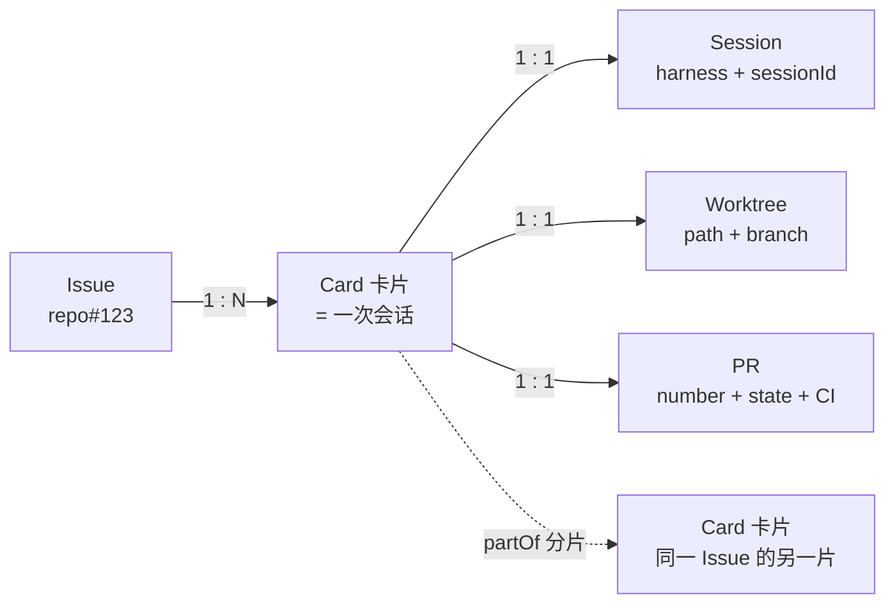
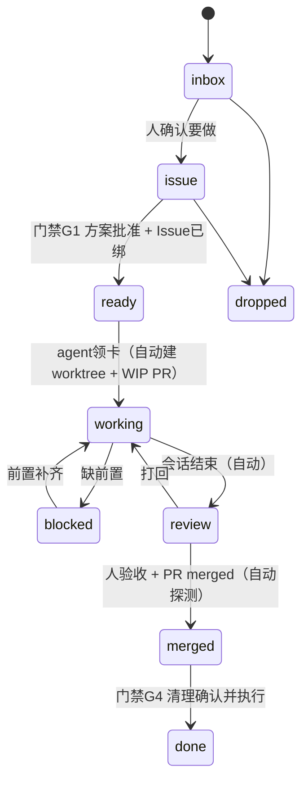

# flowcard 设计

> 只有你一个人用的工作台：**卡片即会话**；每张卡必须携带 **Issue / worktree / PR / 清理** 四项交付要件；流程是固定的一段可执行代码，节点分自动与人工两类。

## 1. 定位与非目标

**做**：承载流程状态与门禁；把交付要件（Issue、worktree、PR、清理）变成卡片上**永远可见的槽位**；挂载并观察 agent 会话；给 agent 一个稳定的写入通道（CLI/HTTP）。

**不做**：

| 不做 | 原因 |
|---|---|
| 起 agent / 管 subagent | 执行归 harness，我们只做交互与门禁 |
| 多用户、权限、账号 | 单机单用户，只监听回环 |
| 代码审查工具 / CI 系统 | 我们只**记录** PR 与 CI 状态，不做审查；§12 的评审只是**本地**记录（行级评论 + 判定），不回写 forge、不代替人点验收 |
| Jira / 云同步 / 桌面壳 / Codex 注入 | 与目标无关，全是维护面 |
| 附件、富文本、甘特、依赖图、i18n | 第一版不要 |
| 模型调用 | 引擎是确定性的（事件→条件→动作） |

## 2. 实体模型



- **Issue 是外部实体**（仓库里的 issue），卡片只持弱引用 `{repo, number, url, title, state}`。
- **一个 Issue 可以对应 N 张卡片**：大需求分多个 PR，每张卡一片、一个会话、一个 PR。
- **Card : Session : Worktree : PR 都是 1:1**。
- **Issue 与 PR 两个槽位永远存在**：没绑定就是 `null`，但**必须渲染出来**（"未绑定" + 可执行的动作），不允许隐藏。

```ts
type Card = {
  id: string;
  title: string;
  body: string;
  state: CardState;
  projectId: string;               // 归属项目（Project.id）；老卡片投影成 "local"
  issue: IssueRef | null;          // 永远存在，可为 null
  pr: PrRef | null;                // 永远存在，可为 null
  worktree: WorktreeRef | null;    // 永远存在，可为 null
  session: Session | null;         // 领卡后才有（agent 会话）
  runtime: Runtime | null;         // 卡片自己的项目运行时（启动按钮管的就是它）
  partOf?: string;                 // 分片：同 Issue 的兄弟卡
  acceptedAt?: string;             // 已验收（等合并）
};

type Session = {
  harness: "omp" | "codex" | "claude" | "other";
  id: string;                      // harness 侧会话标识（omp: getSessionId()，UUID）
  agentKind: "main" | "sub";       // 只有 main 才绑卡片（subagent 也会 emit session_start）
  cwd: string;                     // 每次上报都带 —— 用来校验"会话真的在 worktree 里"
  state: "idle" | "running" | "ended" | "lost";   // lost = 心跳超时
  startedAt: string;
  lastSeenAt: string;
  resumeHint?: string;             // 恢复命令（omp: omp -r <id>）
};

type Runtime = {
  status: "stopped" | "starting" | "running" | "failed";
  pid?: number;                    // 只记自己启动的进程组
  startedAt?: string;
  ports?: number[];                // 探活/冲突提示用
  logPath?: string;
};

type IssueRef  = { repo: string; number: number; url: string; title?: string; state: "open" | "closed" };
type PrRef     = { repo: string; number: number; url: string; branch: string;
                   state: "draft" | "open" | "merged" | "closed"; ci?: "pending" | "pass" | "fail" };
type WorktreeRef = { path: string; branch: string;
                   source: "harness" | "flowcard" };   // 谁建的：harness 的 /wt，还是 flowcard 自己 add
```

### 2.1 项目 = 看板的 Metadata（进入看板先选项目）

**一个实例管若干 git 仓库，项目就是这些仓库的元数据**：进来先选项目，建卡只填正文，`repo` 不再手填。

```ts
type Project = {
  id: string;              // 由仓库根路径派生：仓库目录名 + 路径哈希前 4 位（短、稳定、可读）
  name: string;            // 默认仓库目录名
  path: string;            // 仓库根绝对路径（git rev-parse --show-toplevel）
  remote?: string;         // git remote get-url origin
  headBranch?: string;     // rev-parse --abbrev-ref HEAD（detached 时缺省）
  defaultBranch?: string;  // origin/HEAD 指向的分支；拿不到就回退到存在的 main / master
  lastCommit?: { sha: string; subject: string; at: string };
  dirtyFiles?: number;     // git status --porcelain 的行数
  virtual?: boolean;       // 仅本地存在的合成项目（只有 id="local"、name="未归属"）
  addedAt: string; lastSeenAt: string;
};
```

- **`local` 是必有的合成项目**（`virtual:true`、`path:""`）：所有没归属的卡片、以及**升级前的老卡片**都落在这里，看板上一样能看见。所以 `Card.projectId` 必填（缺省就是 `local`）。
- `repoPath` 仍留在卡片上，但**由 `projectId` 解析出来**（引擎在建卡时把 `project.path` 写进事件），客户端不再传。运行时/探测继续读 `card.repoPath`，不用改。
- **项目用单独的表，不进事件流**：它是"环境元数据"（仓库现在长这样），刷新它不该在看板历史里堆噪声，也没有"谁在什么时候做了什么"要重放。而**卡片归属（`Card.projectId`）走事件**——那是业务事实，必须能重放。投影版本因此 +1（v3），启动时自动 rebuild 一次，老卡片补成 `local`。
- 登记幂等：同 `path` 重复登记只刷新元数据（分支/远程/脏文件会变），`id` 与 `addedAt` 不动；解析按**路径段**比较（复用 `src/shared/paths.ts`，`/a/b` 不匹配 `/a/bc`），嵌套仓库取最具体的那个。
- 只跑只读 git 子命令（`rev-parse` / `remote get-url` / `log` / `status`），**不 fetch、不 push**。

### 2.2 附件 = 图片（正文/评论里直接贴）

- `POST /api/attachments?name=<文件名>`，body 是原始字节 → `{ id, url, markdown, bytes, mime }`；`GET /api/attachments/<id>` 回原始字节。
- **`id` = 内容 sha256 前 16 位** → 内容寻址：同一张图重复上传是同一个 id（天然去重 + 幂等），字节落 `<dataDir>/attachments/<id>.<ext>`。
- 白名单只有 `image/png | image/jpeg | image/gif | image/webp`，单文件 ≤ 10MB。**不收 svg**：svg 里能塞脚本，等于把 XSS 面挂到看板上；**声明什么不算数**，一律按文件头字节嗅探，声明与内容不符也拒。
- GET 带长缓存（`max-age=31536000, immutable`：内容寻址，同一个 id 的内容永不改变）+ `X-Content-Type-Options: nosniff`。
- **标题可选**：`open` 不给 title 时由**服务端**从正文派生（第一条有文本的段落 → 去 markdown 语法 → 折叠空白 → 截 40 字符；纯图/空正文 → `未命名卡片`），并把派生结果**写进事件**——历史稳定，不随规则重算而变。

## 3. 卡片上的"必要项目"（checklist，永远显示）

每张卡片的详情页固定六格，**空着也要显示**，空槽位旁边给出该动作（并标出它属于本地动作还是远程写）：

| # | 必要项目 | 完成判据 | 动作性质 |
|---|---|---|---|
| 1 | **Issue**（建或查） | `issue != null` | 远程写（建 Issue）→ 需确认 |
| 2 | **worktree + 分支** | `worktree != null` **且 `session.cwd` 落在 `worktree.path` 内**（会话真的在里面干活）；分支名 `feat/*` `fix/*` | 本地（或委托 harness 的 `/wt`） |
| 3 | **WIP PR** | `pr != null`（任务一开始就建） | 远程写 → 需确认 |
| 4 | **推送记录** | 至少一条 push 事件（每天可见进度） | 远程写 → 需确认 |
| 5 | **验收** | `acceptedAt != null`（人明确验收） | 人工门禁 |
| 6 | **清理** | 合并后按报告清单拆掉现场 | 人工门禁（报告 → 同意 → 执行） |

硬约束（引擎拦截，不是提醒）：

- 未绑 Issue **不许离开 `issue` 列**（即不许开工）。
- 未建 worktree、未开 PR **不许进入 `review`**。
- **会话没进 worktree 就不算开工**：`ready → working` 要求 `session.cwd` ⊆ `worktree.path`（见 §3.1）。
- PR 未 `merged` **不许进入 `merged` 列**。
- 未清理 **不许 `done`**。
- **PR 合并前绝不清理**：`merged` 之前的任何清理动作一律拒绝。

### 3.1 会话必须进入 worktree 里工作

光建 worktree 不算数——**必须让会话本身在 worktree 里干活**，否则 agent 会继续在主干目录上改文件，等于白建。

事实（omp 18.8.6 实测命令表）：omp 原生支持这条路径，不用我们造轮子

| omp 命令 | 作用 |
|---|---|
| `/wt [<branch>]`（别名 `/worktree`） | **把当前会话移进一个新 worktree，连同未提交改动一起带过去** |
| `/move [<path>]` | 把当前会话移到另一个目录 |
| `/dirs` `/add-dir` `/remove-dir` | 会话的工作目录集合（只读/增删） |

于是有两种落地方式，都接受：

| 方式 | 步骤 | 何时用 |
|---|---|---|
| **A 委托 harness（默认）** | 会话内执行 `/wt feat/xxx` → 绑定 harness 报回的 cwd | 会话已经开着、手上还有未提交改动 |
| **B flowcard 建** | `flowcard worktree add <card> --branch feat/xxx` 建 `.worktrees/<名字>` → 要求会话 `/move <worktree>`（或直接在 worktree 里重开会话） | 想严格控制 worktree 路径与分支名 |

配套的校验与兜底（都是自动的，不靠人自觉）：

1. **每次心跳都带 `cwd`**（M0 已验证 payload 含 `cwd`）→ 引擎拿 `cwd` 与 `worktree.path` 做前缀校验，**通过才允许 `ready → working`**。
2. 未通过时卡片停在 `ready`，并给出确切修复动作：`/wt <branch>`（方式 A）或 `/move <path>`（方式 B）+ 在 worktree 里重开会话的命令。
3. 进入 `working` 之后若 `cwd` 漂出 worktree（`/move` 回主干等）→ 记 `card.cwd.mismatch` 事件，卡片显示警告并回到"未在 worktree"状态（**不改流程状态**，只提示 + 门禁收紧：不许提交、不许 `review`）。
4. `worktree` 槽位里的 `path`/`branch` 优先**从 cwd 反查**（`git -C <cwd> rev-parse --show-toplevel --abbrev-ref HEAD`），避免人手工填错；期望落在项目仓库的 `.worktrees/` 下，不在则记警告但仍接受。
5. **卡片自动识别（M6）**：会话不用再报卡片 id——适配器 `claim` 不给 `card`，服务端按 `session.cwd` 落在谁的 `worktree.path` 里反查（路径段比较，`/a/b` 不匹配 `/a/bc`；多张命中取**路径最长**的那个），零命中或并列最长就回 `NOT_FOUND`，`hint` 里列出可用卡片当参照物。`FLOWCARD_CARD` 保留为显式覆盖。

### 3.2 卡片可以启动自己的项目（运行时）

每张卡片有**一个启动按钮**，启动的是**这张卡片 worktree 里的项目**（dev server / 预览栈之类）。会话是 agent 在干活，运行时是项目在跑——两者都由卡片持有，互不影响。

**每个项目怎么启动是可配置的**：项目仓库内放 `.flowcard.toml`（跟代码一起走、可 review），`[runtime]` 段描述 `cmd`、`cwd`（默认卡片 worktree）、`env`、`ports`、`ready`（按端口或日志正则判就绪）、`singleton`。取不到配置时按钮给出人话错误，而不是崩。

**单例不变式（明确要求）**：启动一张卡的运行时，**先停掉其他卡片已经启着的运行时**（把被停的卡片 id 回给调用方，UI 上要显示出来）。理由很实际：端口、GPU、显存这类资源同时只能给一套栈。`singleton = false` 可关掉（或收窄成"只在同一项目内互斥"）。

**安全边界（硬要求）**：

| 允许 | 禁止 |
|---|---|
| 只对 flowcard 自己启动的**进程组**发 `SIGTERM`，宽限期后 `SIGKILL` | 用 `pkill` / 模式匹配去杀别人的进程 |
| 服务重启/退出时清理自己留下的残留进程 | 杀掉不是自己启动的任何东西 |

**与"多开 subagent"的关系**：会话（含 harness 自己开的 subagent）**可以并行、不受运行时单例限制**；单例只约束"项目进程同时只跑一套"。卡片绑定会话仍然只认 `agentKind === "main"`，subagent 归 harness 自己管。

CLI：`flowcard up <card>` / `flowcard down <card>`；状态变化一样走事件流（`runtime.*`），所以 `rebuild` 之后按钮状态不会漂。

## 4. 流程状态（看板的列）

| 状态 | 含义 | 出口条件 |
|---|---|---|
| `inbox` | 收件箱：原始需求刚进来 | 人确认要做 → `issue` |
| `issue` | **立 Issue**（建或查已有），并写清问题原因与思路 | 门禁 G1：方案批准 **且** `issue != null` → `ready` |
| `ready` | 待开工（Issue 已绑，方案已批） | agent 领卡：建 worktree + WIP PR **并把会话移进 worktree**（`/wt` 或 `/move`，远程写走 G2）→ `working` |
| `working` | 实施中（worktree + PR 已建，多次推送） | 会话结束 / agent 交回 → `review` |
| `review` | 待验收（子徽标：待验收 / 已验收待合并） | 门禁 G3 验收 → 等 PR merged；探测到 merged → `merged` |
| `merged` | 已合并，**待清理**（此处验证现场必须完整保留） | 门禁 G4：报告清理清单 → 同意 → 执行 → `done` |
| `done` | 完成（现场已清理） | — |
| `blocked` | 卡住（必须写明缺什么） | 前置补齐 → `working` |
| `dropped` | 放弃 | — |



**大需求拆多片**：agent 可以在同一边界内**自己新建卡片**（`flowcard spawn`），新卡自动继承 `issue`、带 `partOf` 指向原卡、并要求它自己开一个新 PR。看板上按 Issue 分组显示"这个 Issue 下有哪几片、每片什么状态"。

## 5. 门禁（人工节点）

| 门禁 | 位置 | 批什么 |
|---|---|---|
| `G1 approve` | `issue → ready` | 方案（原因、改法、验收）批准后才许开工 |
| `G2 confirm` | 任何**远程写**：建 Issue、push、开/改 PR、远程评论、合并 | **一事一议**：一次授权只覆盖一次动作，`detail` 带上将要执行的确切命令/URL |
| `G3 review` | `review → 等合并` | 明确验收（不看内容不算过） |
| `G4 cleanup` | `merged → done` | 先报告"删什么、为什么现在可以删、对应 PR 状态"，同意后才执行 |

约定：一张卡同一时刻**最多一个未决门禁**；门禁带 `requestedBy`、`payload`、`decision`（approved/rejected + 理由）。

### 5.1 G2 是凭据，不是流程节点

上面那条「最多一个未决」只管 G1/G3/G4。**G2 不占 `card.gates`，单独放 `card.confirmations`**：它是「这一次操作」的一次性授权，可以有多条、有历史、可以重复申请。

```
agent: requestConfirm{action, detail}   → confirm.requested（pending，detail = 将执行的确切命令/URL）
人:    decideConfirm{id, approved|rejected, reason?} → confirm.decided
agent: consumeConfirm{id}               → confirm.consumed（这条授权就此作废）
```

- **一次批准只覆盖一次动作**：`consumeConfirm` 成功后再执行第二次远程写，必须重新 `requestConfirm`（被 consume / 被驳回的那张永久失效，不能再被 consume）。
- 从措辞推断授权一律不算：`detail` 必须是**这条命令或这个 URL**，且长度有下限；空话、模糊描述连申请都提交不了。
- 驳回**必须写理由**，否则报 `USAGE_ERROR`（agent 要靠它改 detail 再申请）。
- 看板**只申请 / 批准 / 记录**（设计 §10）：`git push`、`tea pr create` 由 agent 或人自己敲。
- 幂等：同一条申请重复发送不会产生第二条；但一件已经结算（用掉/被拒）的事再申请，算**新的一次申请**。

## 6. 事件日志是真相

- 所有写入都是 **append-only 事件**；`cards` 是可重建投影（`flowcard rebuild` 可重放）。
- 每条事件：`{ id, at, actor{kind: human|agent|system, harness?, sessionId?}, cardId, type, payload, dedupeKey }`。
- **幂等**：`dedupeKey` 全局唯一索引；重复写入返回原事件（不报错、不重复）。
- **不抄 `--if-version` 往返**：命令是意图（`approve`/`claim`/`bind`），引擎按当前状态校验；需要断言时用可选 `--if-state`。

事件类型：

```
card.opened          card.state.changed     card.comment.added
card.spawned         card.accepted
issue.bound          issue.created
worktree.created     worktree.removed
pr.opened            pr.updated            pr.merged
push.recorded
gate.requested       gate.decided
cleanup.proposed     cleanup.completed
session.started      session.heartbeat     session.ended
git.probed
session.cwd.mismatch
```

## 7. 流程 DSL（TS 代码）

流程是有类型的代码：条件随便写，"必要项"以 `requires` 声明，引擎在转换时强制校验。

```ts
// src/flow/personal.ts
import { defineFlow } from "../shared/flow.ts";

export default defineFlow({
  states: ["inbox", "issue", "ready", "working", "review", "merged", "done", "blocked", "dropped"],

  gates: [
    { id: "G1", on: ["issue", "ready"],     kind: "approve", title: "批准方案" },
    { id: "G3", on: ["review", "merged"],   kind: "review",  title: "验收", requires: ["pr"] },
    { id: "G4", on: ["merged", "done"],     kind: "cleanup", title: "清理确认", report: ["worktree", "branch"] },
  ],

  requires: {                      // 硬门禁：缺了就拒绝转换，并回一个"缺哪项"的错误
    "issue -> ready":   ["issue", "planApproved"],
    "ready -> working": ["worktree", "pr", "sessionInWorktree"],
    "working -> review": ["pr", "pushedAtLeastOnce"],
    "review -> merged": ["accepted", "pr.merged"],
    "merged -> done":   ["cleanupCompleted"],
  },

  automations: [
    { name: "claim",  on: "session.started", when: c => c.state === "ready",
      do: [{ setState: "working" }] },
    { name: "back",   on: "session.ended", when: c => c.state === "working",
      do: [{ setState: "review" }] },
    { name: "on-merge", on: "pr.merged", when: c => c.state === "review",
      do: [{ setState: "merged" }, { openGate: "G4" }] },
  ],
});
```

引擎形状：`decide(card, event, flow) -> Action[]`，**纯函数**，不碰 IO；动作的执行（写库、调 `git`/`gh`/`tea`、发通知）在薄适配层。

## 8. 写入通道

**HTTP**（Hono + zod，仅回环）：

| 方法 | 路径 | 说明 |
|---|---|---|
| POST | `/api/events` | 批量 append，幂等靠 `dedupeKey` |
| GET | `/api/cards` `/api/cards/:id` | 投影读（卡片恒含 issue/pr/worktree 三槽位） |
| GET | `/api/projects` | 看板 Metadata：全部项目（**恒含合成项目 `local`**） |
| POST | `/api/projects` | `{path}` → 读 git 元数据登记；同 path 幂等（`created:false` 并刷新元数据） |
| GET | `/api/project/current?path=…` | 按路径解析所属项目（给 CLI/看板进来时用）；不在任何项目里 → 404 |
| POST | `/api/attachments?name=…` | body = 图片原始字节（**不解析 JSON**）→ `{id,url,markdown,bytes,mime}` |
| GET | `/api/attachments/:id` | 回原始字节 + 正确 `Content-Type` + 长缓存（内容寻址，可 immutable） |
| GET | `/api/issues/:repo/:number/cards` | 按 Issue 聚合（多 PR 视图） |
| POST | `/api/session/heartbeat` | 会话上报（适配器用，允许高频） |
| GET | `/api/stream` | SSE 广播 |
| POST | `/api/gates/:id/decide` | 人在看板上批准/驳回 |
| GET | `/api/projects/:id/graph?limit=200` | **提交图（只读）**：`git log --graph` 原样输出 + 提交/分支/worktree + 卡片↔分支映射（§12） |
| GET | `/api/cards/:id/diff[?patch=1]` | **卡片 diff（只读）**：`git diff <base>...<head>`（三点）解析成文件/hunk/行号；超阈值置 `truncated`（§12） |
| GET POST | `/api/projects` | 看板 Metadata：`GET` 列项目（恒含合成项目 `local`），`POST {path}` 读一个仓库的 git 元数据并登记 |
| POST GET | `/api/attachments` | 卡片正文的图片输入：`POST /api/attachments?name=…`（body 是图片字节）回 `markdown`，`GET /api/attachments/:id` 发图 |

**CLI**（agent 的唯一写入口，`--json` + `schemaVersion` + 语义化退出码）：

```
flowcard project add <仓库路径>                             # 登记项目（可给仓库内任意子目录，git 自己找根）
flowcard project list                                     # 全部项目（含「未归属」）
flowcard project current [--path <路径>]                  # 当前目录属于哪个项目（默认 cwd；解析不到退出码 3）
flowcard open   [--title "…"] [--body …] [--project <id>]  # 开卡（inbox）；标题可选（服务端按正文派生），项目不给就按 cwd 解析、解析不到用 local
flowcard attach <图片> [--name <文件名>]                    # 传图（png/jpg/jpeg/gif/webp ≤10MB），打印 markdown 直接贴进正文/评论
flowcard issue  <card> --create | --bind <repo>#<n>      # 建或绑定 Issue（→ issue 列）
flowcard plan   <card> --body "方案…"                     # 写方案并申请 G1
flowcard worktree <card> --add --branch feat/x [--at .worktrees/x]  # 建 worktree；随后要求会话 /wt 或 /move 进去
flowcard claim  [<card>] --harness omp --session <id> --cwd <路径>  # 领卡；不给 card 时服务端按 cwd 反查
flowcard pr     <card> --open --base main [--draft]       # 开 WIP PR（走 G2）或 --bind <url>
flowcard push   <card> --sha <sha>                        # 记录一次推送
flowcard confirm <card> --request --for push --detail "git push -u origin feat/x"  # 申请一次远程写确认（G2）
flowcard confirm <card> [--list]                          # 看这张卡的确认与历史（含已批准未用；不给动作标志就是列）
flowcard confirm <card> --approve <cf-id> [--reason "…"]   # 人批准：只覆盖这一次动作
flowcard confirm <card> --reject <cf-id> --reason "…"      # 人驳回：理由必填
flowcard confirm <card> --consume <cf-id>                 # agent 回报：这张授权已经用掉
flowcard beat   <card> --harness omp --session <id>
flowcard end    <card> --summary "…"                      # 交回（→ review）
flowcard accept <card>                                    # 人验收（G3）
flowcard spawn  <card> --title "…"                        # 同一 Issue 下开新片（新 PR）
flowcard up     <card>                                  # 启动卡片运行时（会停掉其他卡片已启动的）
flowcard down   <card>                                  # 停掉卡片运行时
flowcard cleanup <card> [--apply]                         # 列清理清单；--apply 需先过 G4
flowcard detect <card>                                    # 从 worktree/分支探测 PR/CI（gh/tea）
flowcard diff   <card> [--patch]                          # 提交图对比：默认 JSON 摘要；--patch 打原始 unified diff
flowcard review <card> --comment --path <p> --line <n> [--side new|old] --body "…"   # 行级评论（sha 默认取 worktree HEAD）
flowcard review <card> --approve | --request-changes [--body "…"]   # 评审判定（只记录，不改流程状态）
flowcard review <card> --list                             # 看这张卡的评论与判定
flowcard list / show <card> / issue <repo>#<n>            # 读
```

退出码：`0` 成功；`2` 用法错；`3` 状态不允许；**`4` 缺必要条件（回 JSON 说明缺哪一项）**；`5` 服务不可达。

## 9. 会话上报（harness 侧适配器）

| harness | 接入面 | 状态 |
|---|---|---|
| omp | 单文件扩展 + `omp -e <file>`（`--hook` 是等价别名） | ✅ **M0 已验证** |
| codex | `hooks` feature（`SessionStart`/`SessionEnd`/…） | 后置 |
| claude | hooks | 后置 |

**M6（卡片自动识别，已完成）**：适配器 `claim` 不带 `card` → 服务端按会话 `cwd` 反查 `worktree.path`
（路径段比较；多命中取最长；零命中/并列回 `NOT_FOUND` + 可用卡片参照物）；适配器拿到响应里的
`card.id` 后才开始心跳/结束上报，解析失败只记**一次**日志（心跳静默重试），绝不影响会话。
`FLOWCARD_CARD` 保留为显式覆盖；CLI 侧 `flowcard claim --harness omp --session <id> --cwd <路径>`
同样可以不写 card。

**M0 实测事实**（omp 18.8.6，证据与复现命令见 `src/adapters/omp/README.md`）：

- 扩展是**单文件模块**，default export 一个接收扩展 API 的工厂函数；**不需要 manifest，也不需要 `omp install`**；加载即 `omp -e <file>`。
- 身份只能从 handler 的**第二参数 ctx** 取（`session_start`/`session_shutdown` 的事件体是空的）：`ctx.sessionManager.getSessionId()`、`getSessionFile()`、`ctx.cwd`、`ctx.agent = {kind:"main"|"sub", id, …}`。
- 定时器**必须用 `ctx.setInterval`**（contained + unref + shutdown 自动清理）。裸 `setInterval` 回调抛错会变成 `uncaughtException`，**直接拆掉会话**。
- 超时预算：普通 handler 30 s，但 `session_shutdown` 只有 **2 s** → 上报 fetch 超时必须 ≤1.5 s。
- 失败隔离实测有效：端点指向死端口，POST 全失败而 omp 仍 `exit 0`、无 stderr。
- **坑**：RPC 里 `new_session` 之后心跳会切到新 sessionId **而不再触发 `session_start`**。规则：**卡片只认 claim 时那个 sessionId**；未知 id 的心跳不认（记 warn），该卡按 TTL 判失联。
- 版本风险：omp 官方说扩展 API 会变（18.3 移除过 `settings.get/set`）→ 适配器必须独立降级，只依赖最小结构类型。

存活判定：心跳事件按 **30 s 分桶**去重，所以 `lastSeenAt` 的分辨率就是 30 s，TTL 取 **90 s**（≥3 个桶，允许连丢两次心跳）——**TTL 必须显著大于上报分辨率**，否则活着会被判死。超时把 `session.state` 标为 `lost`（**只改徽标，不自动改流程状态**）。**SIGKILL 不会上报 `ended`**，TTL 是唯一兜底。

## 10. 数据与运行

- 数据目录 `~/.local/share/flowcard/`（`FLOWCARD_DATA_DIR` 可覆盖），`db.sqlite` + WAL、以及 `attachments/`（图片附件，按内容 sha 命名）；备份即拷目录。**不塞进项目目录**。
- 远程写一律经门禁 G2，**看板本身不静默执行远程操作**；执行者只能是"你看板上点了确认之后的 CLI/agent"。
- 运行：`systemd --user` 常驻 + 回环监听；Node 22 原生跑 TS，无构建步骤；前端另用 Vite。

## 11. 里程碑

| 里程碑 | 内容 | 验收 |
|---|---|---|
| **M0** ✅ | omp 扩展上报 started/heartbeat/ended | 复现：1+3+1 事件，omp `exit 0`（无推理请求） |
| **M1 内核** | 事件日志 + 投影 + 引擎纯函数 + CLI + HTTP + SSE，含 **Issue/PR/worktree 三槽位与 requires 硬门禁**（先手工绑定） | CLI 走完 `open→issue→plan→批准→worktree→claim→pr→push→end→accept→(模拟 merged)→cleanup`；**cwd 不在 worktree 内时 `working` 转换被拒（退出码 4，并提示 `/wt <branch>` 或 `/move <path>`）**；缺必要项时退出码 4 并指明缺哪项；重启后状态一致、`rebuild` 可重放 |
| **M2 看板** | React + Vite + shadcn；列=9 状态；卡片详情六格必要项**空也显示**；按 Issue 聚合多片 | 浏览器完成 M1 全部动作，SSE 实时 |
| **M3 运行时** | 每卡启动按钮：项目启动配置（`.flowcard.toml`）、进程组启停与日志、**单例不变式**（启动一张卡就停掉其他卡的运行时）、状态进事件流 | 配好配置的项目能一键起停；启 B 之后 A 的进程确实死了（`ps` 验证）；进程组杀干净 |
| **M4 探测** | `git`/`gh`/`tea` 探测：PR 状态、CI、merged、分支/worktree 实况 | 打开卡片能自动反映 PR 与 CI 状态，merged 自动推进 |
| **M5 门禁闭环** | G2 远程写确认（一事一议）、G4 清理报告 | agent 申请 push/开 PR → 卡片出现待办 → 点后方可继续 |
| **M6 适配器正式化** | omp 适配器（含 `agentKind` 过滤、失联判定、**按会话 cwd 自动认卡**）装到日常会话；codex/claude 后置 | 日常干活的会话自动出现在对应卡片上（worktree 里启动 omp，不用给卡片 id） |
| **M7 项目与附件** | 项目 = 看板 Metadata（先选项目再建卡，`repoPath` 由项目解析）；建卡只填正文（标题服务端派生）；图片附件（内容寻址 + 白名单） | `project add` 读真 git 元数据；`open` 不填标题/项目也能落到正确项目与标题；传图后 `GET` 回的字节与 `Content-Type` 与上传一致；老卡片投影成 `local` |
| **M8 提交图与评审** | 文本提交图（`--graph` 原样 + 多 worktree/卡片叠加）、只读 diff（三点）、行级评论、评审判定（**本地事实，不改状态**）（§12） | 真仓库里 `GET /api/projects/:id/graph` 出提交/分支/worktree 实况；带 worktree 的卡片 diff 出 added/modified/deleted/renamed/binary 与行号；approve 不改 `state`；rebuild 与投影一致 |

顺序：M1 → M2 → M3 → M4 → M5 → M6 → M7 → M8（M0、M1–M8 已完成）。

## 12. 提交图与代码评审（第一期：只读 + 本地记录）

目标：在卡片上看**这个仓库现在长什么样**（多 worktree、多分支、谁在哪条泳道上），以及**这一片改了什么**（PR 形式的 diff + 行级评论），并把评审意见留成**本地事实**。

**明确不做（留第二期）**：图形化提交图（自己画泳道）、把评论回写 Gitea / 开真正的 review、按评论自动改流程状态。

### 12.1 提交图（只读）

`GET /api/projects/:id/graph?limit=200`，只跑只读 git 子命令（`log` / `for-each-ref` / `worktree list`）：

- **`graphText` = `git log --graph --oneline --decorate --all -n <limit>` 的原样输出**（只去掉结尾换行）。泳道交给 git 自己画，我们**不重画** —— 前端等宽渲染就是一张图。
- 结构化事实另跑一条 `log --format=%H%x1f%h%x1f%P%x1f%an%x1f%cI%x1f%s%x1f%D`（字段分隔用 `%x1f`，主题里不会出现）：`commits[{sha,short,parents,author,at,subject,refs}]`；`refs` 由 decorate 解析（`HEAD -> main` 只留 `main`）。
- `branches`：`for-each-ref refs/heads`（`name/head/upstream`）；`worktrees`：`worktree list --porcelain`（`path/branch/head/detached`，detached → `branch: null`）。
- `cards`：**只取 store 里有 worktree 的卡片**，按 `worktree.path`（规范化后相等）优先、分支名兜底反查到 worktree 上（`cardId/cardTitle/cardState`）。看板据此把卡片叠到对应泳道上；detached 的 worktree 谁也不匹配，就当它没卡片。
- `limit` 默认 **200**、上限 **1000**（图与响应都要有上限）；分支/worktree 是**实况**不受 limit 影响。
- 空仓库（还没有任何提交）不算错：`graphText` 为空、commits/branches 为空，worktree 照常回。只有 git 不可用或连 `worktree list` 都跑不动才回 `GIT_FAILED`。

### 12.2 diff（只读）

`GET /api/cards/:id/diff`（`?patch=1` 额外带 git 的原始 unified diff 文本）：

- **base** = 项目 `defaultBranch`（拿不到退 `main` / `master`；本地分支优先，其次 `origin/<名字>`）；**head** = 卡片 worktree 的 HEAD（detached 就用 sha）。命令是 **`git diff <baseSha>...<headSha>`（三点 = merge-base 语义）**，在仓库根跑 —— 所以看的是"这条分支相对基线改了什么"，而不是"两者当前差多少"。
- 解析成 `files[{path, oldPath?, status, additions, deletions, hunks[{oldStart,oldLines,newStart,newLines,header,lines[{kind,oldLine?,newLine?,text}]}]}]`。
  - 行体**按 hunk 头声明的行数**（`oldLines + newLines`）吃，所以 `\ No newline at end of file`、空行、夹在中间的任何东西都不会把行号算歪。
  - `status` 判定优先级：**binary > renamed > added > deleted > modified**（一个文件只有一格；二进制文件没有 `---`/`+++` 行，路径从 `diff --git` 头取）。
- 错误：`NO_WORKTREE`（卡片还没绑 worktree，HTTP 层判） / `NO_BASE`（找不到基准分支） / `GIT_FAILED`。
- **大 diff 不硬塞**：默认阈值 **1 MiB**（git 的 `maxBuffer` 也兜一层）。超阈值时只保留**完整的**文件（丢掉后面的）并置 `truncated: true` + `truncatedReason`；被 maxBuffer 截断时最后一个（不完整的）文件一定丢掉。

### 12.3 评审记录（本地事实，走事件流）

**评论与判定是本地事实，不是远程写**：不发给 Gitea、不走 G2 确认、**approve 也不会改流程状态**（G3 验收仍由人在看板上点）。

```
cmd reviewComment { actor, card, sha, path, line, side: "new"|"old", body }   → review.comment.added
cmd reviewVerdict { actor, card, verdict: "approve"|"request_changes"|"comment", body? } → review.verdict.recorded
```

投影 `card.review`（恒存在的槽位）：

```ts
Review = {
  comments: Array<{ id, sha, path, line, side, body, at, actor, outdated }>,
  verdict?: { decision, at, by, body? },
}
```

- **锚点**是 `(sha, path, line, side)`；注释按 **`(path, line, side, at, id)`** 排序 → 同一个位置的多条必然按时间先后。
- **`outdated` 不是事件里的字段**，而是投影时算的：`注释的 sha ≠ 当前 head sha` 就算过期。
  **当前 head = 这张卡最近一次 `push.recorded` 的 sha**（推送就是"HEAD 往前走了"的唯一记录，所以不需要额外的 head 事件）；**一次都没推送时 head 未知 → 一律 `false`**（宁可不说，也不冤枉一条评论）。head 变化时投影把已有注释整体重算一遍，所以 rebuild 之后 `outdated` 不会漂。
- 幂等：同一条评论（同锚点 + 同正文）重发不产生第二条；判定同理（键里只在"前一次判定与这次不同"时带上前值，所以改主意再改回来能记上）。
- CLI：`flowcard review <card> --comment --path <p> --line <n> [--side] [--sha] --body …` / `--approve` / `--request-changes` / `--verdict comment` / `--list`。**`--sha` 不给就取卡片 worktree 的 HEAD**（评论锚在"写评论那一刻的 HEAD"上）。
- `flowcard diff <card>` 默认打 **JSON 摘要**（文件级 + hunk 头，不含行体）；`--patch` 打 git 的**原始 unified diff 文本**。

投影形态变了 → **`PROJECTION_VERSION` +1（v4）**，启动时自动 rebuild 补上 `review` 槽位。
