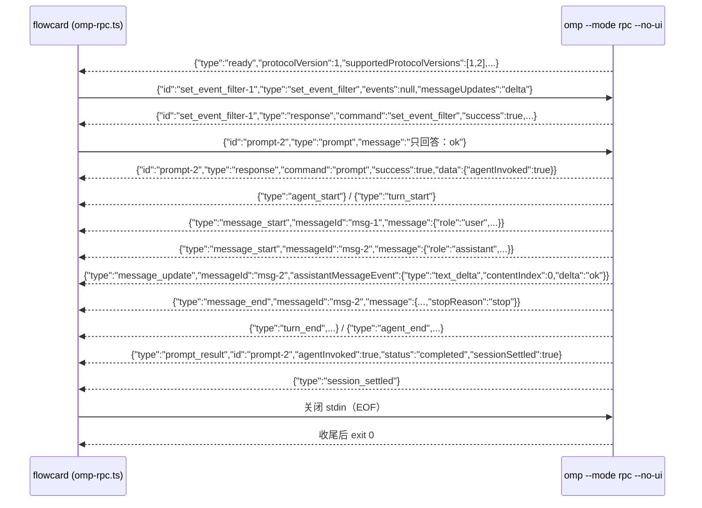

# omp RPC 会话：把「弹终端跑 omp」换成 flowcard 托管

> 里程碑编号留给设计文档定（现有 M0–M9 都已占用），这里只写模块名。

> 代码：`src/server/omp-rpc.ts`（纯解析 + 可注入 IO，范式照 `src/server/probe.ts`）。
> 测试：`test/omp-rpc.test.ts`（假 omp 跑真管道 + 纯解析单测）。
> **帧形状全部抄自 omp 18.8.7 源码**（`<omp-pkg> = ~/.bun/install/global/node_modules/@oh-my-pi/pi-coding-agent`），
> 每条都带文件:行号；只有标注 **[实测]** 的是本机真跑看到的（见 §8）。
> 本文只讲协议与客户端。**接线已经做完**：`src/server/hosted-session.ts` 用它托管每卡一条会话
（HTTP/SSE 契约与取舍见 `docs/design.md` §14）；`src/server/launch.ts` 里只剩找 `omp` 可执行文件与
上报扩展路径两个辅助函数（弹终端那套已删）。

## 1. 结论

omp 的 `--mode rpc` 就是「stdin/stdout 上收发 JSONL」的无头协议：
**命令走 stdin、响应与事件走 stdout**，一个会话是一条长驻子进程。flowcard 托管它，就能把
对话（增量文本/思考/工具调用）与终端输出（工具结果、`command_output`）渲染到网页，
不必再开一个 konsole 窗口。

关键约束（都从源码证实，见下）：

| 事实 | 位置 |
|---|---|
| 启动后**第一帧永远是** `{type:"ready",...}`；不 `negotiate_protocol` 就是 **protocol v1** | `modes/rpc/rpc-mode.ts:1361-1370` |
| v1 下**不会**出现 `rpc_chunk`（分帧是 v2 才有的）；超大帧会被裁剪或降级成 `rpc_frame_error` | `modes/rpc/rpc-frame.ts:18-20,355-388` |
| **stderr 不是协议通道**（协议注释明写 stdout 只放 JSON） | `modes/rpc/rpc-mode.ts:1345-1350` |
| **stdin EOF ⇒ omp 优雅收尾并退出**（所以 `stop()` 先关 stdin） | `modes/rpc/rpc-mode.ts:2676-2691` |
| stdin 上的乱码行只会回一条 `command:"parse"` 的失败响应，**不会**打断会话 | `modes/rpc/rpc-input.ts:46-65`、`rpc-mode.ts:2674` |
| `prompt` 的 `response` 只是「收下了」；真正的终局是 `prompt_result` | `modes/rpc/rpc-types.ts:226-243` |

## 2. 启动

```bash
omp --mode rpc --no-ui --cwd <worktree 路径> [更多参数]
```

- `--mode=rpc`：无头 JSONL 协议（`omp --help`）。
- `--no-ui`：扩展跑在 **headless**，`hasUI=false`，扩展的 `select/confirm/input/editor` 这类
  对话框**不会**发到协议里（`rpc-mode.ts:1659` 传 `uiContext: undefined`，runner 换成 no-op UI）。
- `--cwd=<dir>`：omp 自己的旗标，**必须显式给**（不能赌子进程继承的 cwd）——卡片 cwd 是 worktree。
- `--no-title`（省一次标题模型调用）、`--model`、`--thinking`、`--config <overlay.yml>`、`--session-dir`
  等都是普通 CLI 旗标，照需追加；`rpcArgv()` 默认只拼 `--mode rpc --no-ui --cwd <dir>`。



## 3. 我们用到的命令（stdin，一行一条 JSON）

类型定义在 `rpc-types.ts:35-147`（`RpcCommand` 联合）。本客户端只发这些：

| 命令 | 形状 | 回执 | 说明 |
|---|---|---|---|
| `prompt` | `{id?, type:"prompt", message: string, images?: ImageContent[], streamingBehavior?: "steer"\|"followUp"}` | `{type:"response", command:"prompt", success:true, data?:{agentInvoked}}`（异步，事件随后） | 带 `id` 才能把 `prompt_result` 对回来。**忙时**不带 `streamingBehavior` 会抛 `AgentBusyError`（回 `success:false` + `prompt_result{status:"error"}`）——**不会**排队等空闲 |
| `steer` | `{id?, type:"steer", message: string, images?: ImageContent[]}` | `{... command:"steer", success:true}`（**没有 `data`、也没有 `prompt_result`**） | 忙时插话：入 steering 队列，下一个边界注入当前这一轮。语义/细节见 §3.2 |
| `follow_up` | `{id?, type:"follow_up", message, images?}` | `{... command:"follow_up", success:true}` | 入 follow-up 队列：**这一程结束**后才处理 |
| `abort` | `{id?, type:"abort"}` | `{... command:"abort", success:true}` | 中断当前 run（**不清排队**，见 §3.2 尾） |
| `new_session` | `{id?, type:"new_session", parentSession?}` | `{... command:"new_session", data:{cancelled:boolean}}` | **回执里没有 sessionId**，要再 `get_state`（见 §9） |
| `get_state` | `{id?, type:"get_state"}` | `data: RpcSessionState`（含 `sessionId`、`isStreaming`、`isSettled`、`queuedMessages`、`model`…） | `rpc-types.ts:151-199` |
| `get_session_stats` | `{id?, type:"get_session_stats"}` | `data: SessionStats`（`tokens:{input,output,reasoning,cacheRead,cacheWrite,total}`、`cost`、`sessionFile`） | 花费就用它 |
| `set_event_filter` | `{id?, type:"set_event_filter", events: string[]\|null, messageUpdates?: "full"\|"delta"}` | `data:{events, messageUpdates}` | **建议第一步就发**（见 §6） |
| `extension_ui_response` | `{type:"extension_ui_response", id, value\|confirmed\|cancelled\|answers}` | — | 回 UI 请求；`--no-ui` 下正常不会有请求 |

失败回执统一是 `{id?, type:"response", command: <string>, success:false, error: string, code?: string}`
（`rpc-types.ts:601`），**任何命令都可能失败**，客户端必须按 `id` 关联。

### 3.1 客户端 API（`src/server/omp-rpc.ts`）

```ts
const session = startRpcSession({ cwd, ompPath?, args?, env?, spawn?, readyTimeoutMs? }); // 同步返回，不抛
await session.ready;                       // {ok:true,protocolVersion,...} | {ok:false,reason:"exit"|"error"|"timeout"}
const off = session.on((event) => …);      // 订阅简化事件（OmpEvent），返回退订函数
session.setEventFilter(null, "delta");     // 建议第一件事
const promptId = session.prompt("…", { images? });   // 返回自己生成的 id，用来跟 result 对齐
const steerId = session.steer("…", { images? });     // 中途引导（`type:"steer"`），同样返回 id（见 §3.2）
await session.request({ type: "get_state" }, { timeoutMs: 10_000 });  // 按 id 关联，永不 reject
session.abort(); session.newSession(); session.getState(); session.getSessionStats();
session.textFor("msg-2");                  // 已拼好的纯文本
session.stats();                           // {droppedFrames, receivedFrames, badLines}
await session.stop({ graceMs, killGraceMs });  // 幂等；返 {code, signal, forced}
```

`send()` 是逃生口（发任意 `RpcCommand`）；`request()` 在 `send()` 之上按 `id` 等回执。
自己发的 `abort`（不带 id）在实测里回执是 `id: null` —— 需要关联就用 `request({type:"abort"})`。

### 3.2 忙时插话：`steer` / `follow_up`（与 `prompt` 的区别）

**`prompt` 不会排队。** 会话正忙（`session.isStreaming`）时，`prompt` **不带** `streamingBehavior` 就是
直接抛错：RPC 回一条 `success:false` 的 `response`（`error:"Agent is already processing. …"`），
并把 ticket 记成 `prompt_result{status:"error"}`（`rpc-mode.ts:2058-2064` 的 `AgentBusyError`、
`agent-session.ts:7405-7412` 的 `if (this.isStreaming)` 分支）。所以「等它忙完再发」是要客户端自己排，
omp 不给这个队。想**插进去**有三条路（源码 `rpc-mode.ts:1889-1892`）：

| 写法 | 忙时行为 | 闲时行为 | 有 `prompt_result` 吗 |
|---|---|---|---|
| `{type:"steer", message}` | 入 **steering 队列**：下一个边界注入当前这一轮 | 入队后由 omp 自己起一轮（见下） | **没有**（`rpc-mode.ts:1891` 传 `undefined` ticket） |
| `{type:"follow_up", message}` | 入 **follow-up 队列**：这一程结束后才处理 | 同上 | **没有** |
| `{type:"prompt", …, streamingBehavior:"steer"\|"followUp"}` | 等价于上面两条（同一条 `#queueUserMessage` 路径） | 正常起一轮 | **有**（ticket 跟着排队的那条消息走，`rpc-prompt-results.ts:46-50`） |

**插入点在哪**（agent-core 的循环，`pi-agent-core/src/agent-loop.ts`）：
- 每个 **tool 批次边界**与 run 开始时 poll steering 队列（`:1222,1251,1297`）。正在跑的**原子工具不会被砍**。
- `wait`/`vibe` 这类「纯等待」的 interruptible 工具会收到 steering 信号**提前收工**（`:152-153,3238-3246`），
  消息随后在边界注入 —— 所以按了引导，等待里的会话能立刻动起来（不是等整个 run 完）。
- 支持 live steering 的 provider 能把它**活投进正在流的那条响应**（`:1874-1878`）；这些算 `liveSteered`，
  `remove_queued_message` 也撤不回来。

**连发多条**（`pi-agent-core/src/agent.ts`）：
- `steer` 就是一条一条 `push` 进队列（`:1376-1377`）——**不去重、不合并、不拒绝**；每次队列变化推一条
  `queue_update{steering:[…], followUp:[…], liveSteered}`。
- 取用时按 `steeringMode` 决定一批取几条：**默认 `one-at-a-time`**（`modes/settings.ts:749-753`）——
  每个边界只投**一条**，剩下的留到后面的边界；`all` 才一次全投（`agent.ts:1482-1494`）。
- 文本按 FIFO 顺序，原文不改（模板/斜杠命令会被展开，`agent-session.ts:8237-8242`）。

**空闲时发 `steer`** 也会跑：`#canAutoContinueForFollowUp()` 见到 steering 队列非空就放行
（`agent-session.ts:8490-8499`），omp 自己把这一轮起起来 —— 但那一轮**没有 `prompt_result`**，
只有事件流 + 收尾的 `session_settled`。

**失败长什么样**：忙**不是**失败条件。只有文本以 `/` 开头且命中扩展命令注册表时抛错
（`agent-session.ts:8237-8240`），表现为一条 `success:false` 的 `response`。

**`abort` 与排队的关系**（`agent-session.ts:9692-9785`）：`abort` 只 abort 当前 run 的 controller
（`agent.ts:1529-1531`），**不清空** steering/follow-up 队列；abort 期间 `#abortInProgress` 先挡住 drain，
收尾的 `finally` 再 `#drainStrandedQueuedMessages()`（`:9780-9784`）——**排队的用户 steer 保留，
并立刻被跑成新的一轮**（advisor 卡例外：中断时被提取出来重新记成可见建议，不触发轮次）。
想「中断并把排队撤回来」是另一个命令 `abort_and_restore_queue`（回执里带回被撤下的消息）。

**flowcard 怎么接**（`hosted-session.ts` 的 `prompt(...,{steer})` ← `POST /api/cards/:id/session/prompt`）：
- 忙（本进程的 `busy || awaitingSettle`）→ 发 `steer`；闲 → 发 `prompt`（**带** `streamingBehavior:"steer"`
  兜底：万一这一刻判错，omp 会把它排进 steering 队列，而不是回 busy 错）。
- 回执里 `delivery:"steer"|"prompt"` 说清这次实际走了哪条路；omp 的 `queue_update` 原样转成 SSE 的
  `queue` 事件（前端据此显示「已引导、还没被模型读到」）。
- 本节的语义核对的是**本机装的 `@oh-my-pi/pi-coding-agent` 18.9.0** 源码（`omp --version` 也是 18.9.0）；
  帧形状与 18.8.7 一致（§8 那次真机验证就是 18.8.7）。

**真机验证（2026-10-11，omp 18.9.0，`choosec/deepseek-flash`）**：临时脚本 `/tmp/fc-steer/drive.mjs`
（不在仓库里）直接开 `omp --mode rpc --no-ui` 真管道，日志 `/tmp/fc-steer/abort.log`。两次观测：

1. **忙时 `steer` 插进当前这一轮**（同一 run，`agent_start` 计数不变）：发 `prompt` 后 0.9 s 发
   `steer` → `queue_update{steering:["…"],liveSteered:0}`，`response{command:"steer",success:true}`；
   run 跑到 tool 批次边界时 `queue_update{steering:[]}` → `turn_start` → 一条 `{"role":"user",
   "steering":true}` 的用户消息出现在转录里，模型接着这条继续答。同一份日志还看到：等待中的
   `bash sleep 6` 被 steering 信号**提前收工**（`tool_execution_end` 的文本是 “Backgrounded early
   to handle an incoming message; the command keeps running.”）——命令没被杀，转后台继续跑。
2. **`abort` 后排队里的 steer 保留并起新的一轮**：`steer` 入队（`queue_update{steering:["别等了…"]}`）
   → 1.8 s 后 `abort` → `response{command:"abort",success:true}`、`queue_update{steering:[]}`、
   **`agent_start`（第 2 次）**、`prompt_result{id:"p1",status:"aborted",sessionSettled:false}`（因为
   还有排队活没做完）→ 新的一轮把那条 steer 当作用户消息吃进去（`steering:true`）→ 最后一条
   `session_settled`。**排队不丢**，`abort` 不是「清空队列表」。

## 4. 帧清单（stdout）

### 4.1 协议帧（非会话事件）

| 帧 | 形状（抄自源码） | 出处 |
|---|---|---|
| `ready` | `{type:"ready", protocolVersion:1, supportedProtocolVersions:[1,2], maxFrameBytes:1048576, maxReassembledFrameBytes:67108864}` **[实测]** | `rpc-types.ts:317-323`、`rpc-mode.ts:1361-1370` |
| `response` | `{id?, type:"response", command:string, success:true, data?: unknown}`（`data` 按命令不同） | `rpc-types.ts:369-...` |
| `response{success:false}` | `{id?, type:"response", command:string, success:false, error:string, code?:string}` | `rpc-types.ts:601` |
| `prompt_result` | `{type:"prompt_result", id?, agentInvoked:boolean, status:"completed"\|"aborted"\|"error", error?:{message,provider?,model?,httpStatus?,retryable}, sessionSettled:boolean}` **[实测]** | `rpc-types.ts:212-245`、状态取自最终 assistant 消息的 `stopReason`（`rpc-prompt-results.ts:170-180`） |
| `session_settled` | `{type:"session_settled"}` **[实测]** | `rpc-types.ts:252-254` |
| `command_output` | `{type:"command_output", text:string}`（内建斜杠命令的输出） | `rpc-types.ts` 见 `wire/frames.ts:114`、`rpc-mode.ts:1803` |
| `available_commands_update` | `{type:"available_commands_update", commands: RpcAvailableSlashCommand[]}` **[实测]**（启动与每次会话切换后各一条，**很大**） | `rpc-types.ts:206-209` |
| `extension_ui_request` | `{type:"extension_ui_request", id:string, method:"select"\|"confirm"\|"input"\|"editor"\|"ask"\|"cancel"\|"notify"\|"setStatus"\|"setWidget"\|"setTitle"\|"set_editor_text"\|"open_url", ...}` | `rpc-types.ts:692-...` |
| `extension_error` | `{type:"extension_error", extensionPath:string, event:string, error:string}` | `rpc-mode.ts:1650` |
| `rpc_frame_error` | `{type:"rpc_frame_error", originalType?, error}`（帧超传输上限被换掉） | `rpc-frame.ts:277-302` |
| `rpc_chunk` | `{type:"rpc_chunk", chunkId, index, count, byteLength, data}` —— **只在 negotiate 了 v2 时才可能出现；我们不 negotiate** | `rpc-types.ts:325-332`、`rpc-frame.ts:354-366` |
| `host_tool_call` / `host_uri_request` … | 只在宿主 `set_host_tools`/`set_host_uri_schemes` 之后才来；**我们从不注册** | `rpc-types.ts:760-860` |

### 4.2 会话事件帧（`AgentSessionEvent`，可能被 `set_event_filter` 过滤）

事件类型清单抄自 `session/agent-session-events.ts:14-89`（`AgentSessionEvent` =
`pi-agent-core` 的 `AgentEvent`（`types.ts:1241-1264`）去掉 `agent_end` 再扩展）。本模块
`SESSION_EVENT_TYPES` 是同一张表。常用形状：

| 帧 | 形状 | 出处 |
|---|---|---|
| `agent_start` | `{type:"agent_start"}` **[实测]** | `pi-agent-core/types.ts:1243` |
| `agent_end` | `{type:"agent_end", messages: AgentMessage[], isTerminal?, yielded?, awaitingAsyncWork?}` —— **`messages` 常被编码器裁成 `[]`**（已流过的消息不再重发，另有 `messageCount`） | `pi-agent-core/types.ts:1244-1251`、`rpc-frame.ts:251-276` |
| `turn_start` / `turn_end` | `{type:"turn_start"}` / `{type:"turn_end", message: AgentMessage, toolResults: ToolResultMessage[]}` **[实测]** | `pi-agent-core/types.ts:1252-1253` |
| `message_start` | `{type:"message_start", message: AgentMessage, messageId: string}` **[实测]** | `pi-agent-core/types.ts:1255` + `rpc-types.ts:649` 盖 `messageId` |
| `message_update` | `{type:"message_update", message: AgentMessage, assistantMessageEvent: AssistantMessageEvent, messageId}` **[实测]** | 同上 |
| `message_end` | `{type:"message_end", message: AgentMessage, messageId}` **[实测]**（`message.stopReason` = `"stop"\|"length"\|"toolUse"\|"aborted"\|"error"`） | 同上 |
| `tool_execution_start` | `{type:"tool_execution_start", toolCallId, toolName, args:any, intent?:string}` | `pi-agent-core/types.ts:1260-1265` |
| `tool_execution_update` | `{type:"tool_execution_update", toolCallId, toolName, args, partialResult}`（**终端实时输出的来源**） | 同上 |
| `tool_execution_end` | `{type:"tool_execution_end", toolCallId, toolName, result, isError?:boolean}` | 同上 |
| `notice` | `{type:"notice", level:"info"\|"warning"\|"error", message, source?}` | `agent-session-events.ts:74` |
| `queue_update` | `{type:"queue_update", steering:string[], followUp:string[], liveSteered?:number}` —— 队头里已活投进流式响应的条数（§3.2） | `agent-session-events.ts:88`、`rpc-session-events.ts` |
| 其他 | `auto_compaction_*`、`auto_retry_*`、`cache_warming_*`、`model_changed`、`advisor_cost_changed` **[实测]**、`thinking_level_changed`、`todo_*`、`goal_updated`、`ttsr_triggered`、`irc_message`、`retry_fallback_*`、`config_warnings_changed` | `agent-session-events.ts:34-88` |

`messageId` 是 **RPC 模式自己盖的**（`msg-1`、`msg-2`…，进程内唯一），
`message_start` / 每条 `message_update` / `message_end` 共享同一个 id；
过滤开关中途变化也不会把一条消息劈成两个 id（`rpc-session-events.ts:59-87`）。

### 4.3 `AssistantMessageEvent`（`message_update` 里的增量；抄自 `pi-ai/types.ts:1590-1624`）

```
{ type:"start",          contentIndex?:undefined, partial: AssistantMessage }
{ type:"text_start",      contentIndex:number,                 partial }
{ type:"text_delta",      contentIndex:number, delta:string,   partial }
{ type:"text_end",        contentIndex:number, content:string, partial }
{ type:"thinking_start",  contentIndex:number,                 partial }
{ type:"thinking_delta",  contentIndex:number, delta:string,   partial }
{ type:"thinking_end",    contentIndex:number, content:string, partial }
{ type:"image_end",       contentIndex:number, content:ImageContent, partial }
{ type:"toolcall_start",  contentIndex:number,                 partial }
{ type:"toolcall_delta",  contentIndex:number, delta:string,   partial }
{ type:"toolcall_end",    contentIndex:number, toolCall: ToolCall, partial }
{ type:"done",  reason:"stop"|"length"|"toolUse", message: AssistantMessage }
{ type:"error", reason:"aborted"|"error",         error: AssistantMessage }
```

`ToolCall = {type:"toolCall", id, name, arguments: Record<string,unknown>, intent?: string}`（`pi-ai/types.ts:990-997`）。
**`set_event_filter {messageUpdates:"delta"}` 之后**：`message_update.message` 只剩 `{role}`、
`assistantMessageEvent` 里的 `partial` 被剥掉（`rpc-session-events.ts:15-22,48-55`），
所以增量客户端**只该读 `assistantMessageEvent` 的 `type/delta/contentIndex/content/toolCall`**——
本模块就是这么写的，两种投影都吃。

## 5. 归一化映射（原始帧 → flowcard 的 `OmpEvent`）

`FrameNormalizer.push(frame: OmpFrame): OmpEvent[]`。核心 7 类 + 为了不丢信息保留的其余：

| 原始 | `OmpEvent` |
|---|---|
| `message_update` + `assistantMessageEvent.type="text_delta"` | `{kind:"text", messageId, contentIndex, delta}` |
| `message_update` + `text_end` | `{kind:"text_end", messageId, contentIndex, text}`（`content` 是权威块文本） |
| `message_update` + `thinking_delta` / `thinking_end` | `{kind:"thinking",…}` / `{kind:"thinking_end",…}` |
| `message_update` + `toolcall_start/delta/end` | `{kind:"toolcall", phase:"start"\|"delta"\|"end", messageId, contentIndex, toolName?, toolCallId?}` |
| `message_update` + `start`/`text_start`/`thinking_start`/`image_end`/`done`/`error` | `{kind:"other", type:"message_update.<原类型>", raw}` |
| `tool_execution_start/update/end` | `{kind:"tool", phase:"start"\|"update"\|"end", toolCallId, toolName, args, intent, result, isError}` |
| `turn_start` / `turn_end` | `{kind:"turn", phase, toolResults}` |
| `agent_start` / `agent_end` | `{kind:"agent", phase}` |
| `message_start` / `message_end` | `{kind:"message", phase, messageId, role, text, stopReason}`（`text` 是拼好的文本，见 §6） |
| `notice` | `{kind:"notice", level, message, source}` |
| `queue_update` | `{kind:"queue", steering, followUp, liveSteered}` |
| `prompt_result` | `{kind:"result", id, agentInvoked, status, error, retryable, sessionSettled}` ← **本协议里 `id` 的用途就是这个** |
| `session_settled` | `{kind:"settled"}` |
| `ready` | `{kind:"ready", protocolVersion, supportedProtocolVersions, maxFrameBytes}` |
| `response`（成功） | `{kind:"response", command, id, data}` |
| `response{success:false}` | `{kind:"error", scope:"command", message:"<cmd>: <error>", code, id, command}` |
| `rpc_frame_error` | `{kind:"error", scope:"protocol", message, code:originalType}` |
| `extension_error` | `{kind:"notice", level:"error", source:"extension", message:"<path> <event>: <error>"}` |
| `command_output` | `{kind:"command_output", text}` |
| `extension_ui_request` | `{kind:"ui", id, method, request}`（原始帧整包带着；`--no-ui` 下不该出现） |
| 其余会话事件（上表 §4.2 尾部的那些） | `{kind:"other", type, raw}` —— **不丢信息**，网页可以只显示一部分 |
| `available_commands_update` / `rpc_chunk` / `host_*` / 真未知类型 | **丢弃并计数**（`stats().droppedFrames`），不报错 |
| 进程层面：乱码行 / 超长行 / spawn 失败 / 退出后写管道 | `error{scope:"protocol"\|"spawn"\|"io"}`、`exit{code,signal}` |

**什么都不抛**：`parseFrame` 对空行/乱码/非对象 JSON 返回 `null`；未知帧走 `{kind:"unknown"}`；
spawn 同步抛错、`error`/`exit` 事件、stdin EPIPE 全部转成 `error`+`exit` 事件；
`startRpcSession` 同步返回句柄，失败通过 `handle.ready`（`{ok:false, reason:"exit"|"error"|"timeout"}`）表达。

## 6. 怎么把纯文本回答拼出来

规则（`FrameNormalizer`，`textFor(messageId)`）：

1. **按 `messageId` 归并**，绝不跨 id 合并：一条 `messageId` = 一条消息（用户消息与助手消息各有自己的 id）。
2. 一条消息内部**按 `contentIndex` 分块**累计 `text_delta.delta`；多块按 `contentIndex` 升序拼接（`join("")`）。
3. `text_end.content` 到了就**整块覆盖**（同一块可能收到多次 end，`content` 是权威值）。
4. `message_end.message.content` 里的 `text` 块**再覆盖一次**（`textFromMessage()` 只取 `type:"text"` 的块，
   `thinking`/`toolCall` 不算回答），它是这条消息最终的权威文本。
5. `agent_end.messages` **不能**当最终文本来源：编码器会把已流过的消息裁掉（`rpc-frame.ts:251-276`）。

所以网页侧只需要：增量 `text` 直接往气泡上追加；`message` (phase `end`) 到了就用它的 `text` 校正
（防丢包/重连后的对齐）；`result` 到了收尾（`status` 决定语气）。`text_end` 用来切块更细的渲染。

`new_session` / `switch_session` 之后必须 `normalizer.reset()`（本模块 `newSession()` 里做了），
否则新会话的 `msg-1` 可能跟旧会话的 `msg-1` 撞车。

## 7. 一条会话的时序（真机观测到的顺序）

```
[+0.00s] spawn: omp --mode rpc --no-ui --cwd /tmp/fc-rpc ...
[+0.77s] ← ready{protocolVersion:1,...}
         → set_event_filter{events:null, messageUpdates:"delta"}   ← 建议第一步
[+0.88s] ← advisor_cost_changed（会话事件，归 other）
[+0.89s] ← response{command:"set_event_filter"}
[+0.90s] → prompt{id:"prompt-2", message:"只回答：ok"}
[+0.90s] ← response{command:"prompt"}                 ← 只是「收下了」，data.agentInvoked
[+0.93s] ← agent_start
[+0.96s] ← turn_start
[+0.96s] ← message_start{messageId:"msg-1", message:{role:"user",...}} / message_end{msg-1}
[+1.74s] ← message_start{messageId:"msg-2", message:{role:"assistant",content:[]}}
[+1.74s] ← message_update{msg-2, assistantMessageEvent:{type:"text_start",contentIndex:0}}
[+1.74s] ← message_update{msg-2, ...{type:"text_delta",contentIndex:0,delta:"ok"}}
[+1.74s] ← message_update{msg-2, ...{type:"text_end",contentIndex:0,content:"ok"}}
[+1.74s] ← message_end{msg-2, message:{...,"stopReason":"stop"}}
[+1.75s] ← turn_end{toolResults:[]}
[+1.76s] ← agent_end{messages:[]}                      ← messages 被裁空，别当文本来源
[+1.77s] ← prompt_result{id:"prompt-2", status:"completed", sessionSettled:true}
[+1.77s] ← session_settled
```

`abort` 的时序（真机，同样一次跑里做的第二次 prompt）：

```
[+1.78s] → prompt{id:"prompt-7"}                        ← 「请从 1 数到 500」
[+2.29s] ← message_start{msg-4, assistant} / thinking_delta ×N（模型先想）
[+2.75s] ← text_start{contentIndex:1} / text_delta "1"
[+2.75s] → abort()
[+2.75s] ← text_delta "\n" / "2"                        ← abort 之后**还会有**几帧（在途数据）
[+2.77s] ← message_end{msg-4, "stopReason":"aborted"}
[+2.77s] ← turn_end / agent_end
[+2.77s] ← response{command:"abort"}                    ← abort 回执排在 run 的事件**之后**
[+2.78s] ← prompt_result{id:"prompt-7", status:"aborted", sessionSettled:true}
[+2.78s] ← session_settled                              ← 之后只剩我们主动发的 get_state 回执
```

两条结论：**（a）** 不要用 `abort` 的回执判断「停了」，要用 `prompt_result.status`；
**（b）** `prompt_result` 之后（`sessionSettled:true` 时）再发一条 `get_state`，就是一条
确定性的「管道已排干」屏障（同一条管道 FIFO，回执之后的帧不存在）。

## 8. 真机验证（一次性，最小化）

方法：`/tmp/fc-rpc/verify.ts`（临时脚本，**不在仓库里**）直接 import `src/server/omp-rpc.ts`，
用 `spawn` 注入口在真子进程上再挂一个 stdout tee，既拿归一化事件也留原始帧。

```bash
node /tmp/fc-rpc/verify.ts        # 真机：omp 18.8.7，cwd=/tmp/fc-rpc
DRY_RUN=1 node /tmp/fc-rpc/verify.ts   # 先干跑：argv 换成 node /tmp/fc-rpc/fake-omp.cjs（0 额度）
```

用到的 omp 参数（都是 CLI 旗标）：

```bash
omp --mode rpc --no-ui --cwd /tmp/fc-rpc \
    --model example/deepseek-flash --thinking off --no-title \
    --no-extensions --no-skills --no-rules --no-lsp --auto-approve \
    --session-dir /tmp/fc-rpc/sessions \
    --config /tmp/fc-rpc/omp-rpc-overlay.yml     # 只关掉 autolearn + idle compaction，避免额外模型调用
```

只有 **2 次 prompt**（第二次立刻 abort），跑完 **2.8 秒**；`get_state`/`get_session_stats`/`new_session`
都是本地命令、不花钱。日志：`/tmp/fc-rpc/verify-real.log`（184 行）。

结果（原文节选）：

```
READY {"ok":true,"protocolVersion":1,"supportedProtocolVersions":[1,2],"maxFrameBytes":1048576,"ms":769}
RESULT#1 {"kind":"result","id":"prompt-2","agentInvoked":true,"status":"completed","error":null,"retryable":false,"sessionSettled":true}
ASSEMBLED-TEXT ok                       ← msg-2 拼出来就是 "ok"
STATE#1 sessionId=01a1249c-5018-77b6-b640-1b2d070b769e
NEW_SESSION {"ok":true,"data":{"cancelled":false}}
STATE#2 sessionId=01a1249c-54da-739b-843e-410978794c2b    ← ★ sessionId 会变（见 §9）
RESULT#2 {"kind":"result","id":"prompt-7","agentInvoked":true,"status":"aborted","sessionSettled":true}
BARRIER settled 之后只多了 1 条事件（只有 get_state 回执=true, ok=true）
STOP {"code":0,"signal":null,"forced":false} stderr=       ← 关 stdin 后自己退，没动信号
CLIENT-STATS {"droppedFrames":2,"receivedFrames":164,"badLines":0}
RAW-UNPARSEABLE-LINES 0
DONE wallclock=2.8s
RAW-FRAME-HISTOGRAM [["event:message_update",130],["response",10],["event:message_start",4],
 ["event:message_end",4],["unknown",2],["event:agent_start",2],["event:turn_start",2],
 ["event:turn_end",2],["event:agent_end",2],["prompt_result",2],["session_settled",2],
 ["ready",1],["event:advisor_cost_changed",1]]
```

- `CLIENT-STATS droppedFrames:2` = 直方图里那 2 条 `unknown`，也就是启动时与 `new_session` 之后
  各一条 `available_commands_update`（斜杠命令全表，flowcard 不用）。**这次真机跑就是发现它的地方**：
  看到 2 条 unknown 帧 → 查源码确认是 `rpc-types.ts:206` 的 `available_commands_update` →
  已在 `classifyFrame` 里显式认得，归一化时照旧丢弃并计数（不再算「未知」，另有单测）。
- 花费（`get_session_stats` / 会话文件里的 `usage`）：第一条 prompt
  `input 8113, output 2, cacheRead 256, cacheWrite 0, total 8371 tokens, cost 0`
  （8.1k 输入基本都是系统提示词+工具表；`cost` 由 router 报 0）；被 abort 的那条 usage 全 0。
  整个验证跑下来 ≈ **8.4k tokens、报告 cost 0**（`example` 路由不计价）。

## 9. 未知项与坑

1. **`new_session` 之后 `sessionId` 会变**（实测：`01a1249c-5018…` → `01a1249c-54da…`）。
   回执只有 `{cancelled}`，**必须**再 `get_state` 重新取。这也是 M0 在扩展侧踩过的坑：
   卡片主键如果拿 `sessionId`，切会话后要**显式改绑**，不能沿用旧值。
2. **`extension_ui_request` 要不要应答？** `--no-ui` 下扩展是 headless（`rpc-mode.ts:1659`），
   `select/confirm/input/editor` 不走协议，实测一轮里一条都没出现。但 `ask` 是宿主
   `set_ask_dialog` 显式打开的（我们不发，就不会来）；`cancel/notify/setStatus/setWidget/setTitle/
   set_editor_text/open_url` 是单向通知，**不需要应答**。真需要应答的（`select/confirm/input/editor`）
   若出现且没人回，会一直挂着直到 `timeout` 或 abort（`rpc-mode.ts:1160-1270`）——
   本模块只把它变成 `{kind:"ui", …}` 交给上层；**托管会话（`hosted-session.ts`）收到一律回
   `{type:"extension_ui_response", id, cancelled:true}` 并推一条 notice 兜底**，不让会话挂住。
3. **图片输入**没验证：`prompt.images?: ImageContent[]`（`rpc-types.ts:40`）形状来自 `pi-ai`，
   本模块 `prompt(msg,{images})` 原样透传，但没跑过真图。UI 侧还要确认图从哪来（上传 or 附件槽）。
4. **tool 审批**没验证：headless 下审批怎么表现（`--auto-approve` 绕过了）没测；带工具的真实会话要再验一次。
5. **`agent_end.messages` 会被裁空**（实测 `messages:[]`，`messageCount` 另给）——别拿它当最终文本。
6. **protocol v2 没走**：v2 会把超过 1 MiB 的逻辑帧拆成 `rpc_chunk`（需要重组），并且
   `response` 能到 64 MiB。我们停在 v1，换来的是「不会出现分块帧」，代价是超大帧可能被裁剪或
   降级成 `rpc_frame_error`（本模块把它变成 `error{scope:"protocol"}`）。
7. **`--no-ui` 的真正含义**是「扩展 headless」，不是「RPC 协议无 UI 帧」；
   `rpc-ui` 模式才是「工具 UI 也走协议」。flowcard 用 `--no-ui`。
8. **`stop()` 的语义**：先关 stdin（omp 走 EOF 收尾路径 → `disposeAndExit()`），默认 2 s 没退才
   SIGTERM、再 2 s 才 SIGKILL；实测 0.03 s 内自己 `exit 0`，`forced:false`。
9. **`session_settled` 不是终局，子进程没了也不等于会话作废**（真机实测，见 §8 与
   `docs/design.md` §14.3.9/10）：一轮 `prompt_result{sessionSettled:true}` + `session_settled`
   之后子进程**还活着**，同一条会话接着发 prompt 照答；omp 只认 stdin EOF（或扩展 `pi.shutdown()`）。
   反过来说，**往已经死掉的子进程 stdin 写**拿到的是**异步** EPIPE —— `write()` 里的 try/catch 抓不到，
   没人听就是未捕获异常（能把宿主进程带走）。本模块挂了 stdin 的 `error` 监听，把它降级成
   `error{scope:"io"}` 事件；`hosted-session.ts` 的 `refreshStats` 也先看 `exited` 再问。
   续接同一条会话用 `-r <会话文件>`（`--cwd` 在 `-r` 时被忽略，cwd 取文件头里的那个）。
